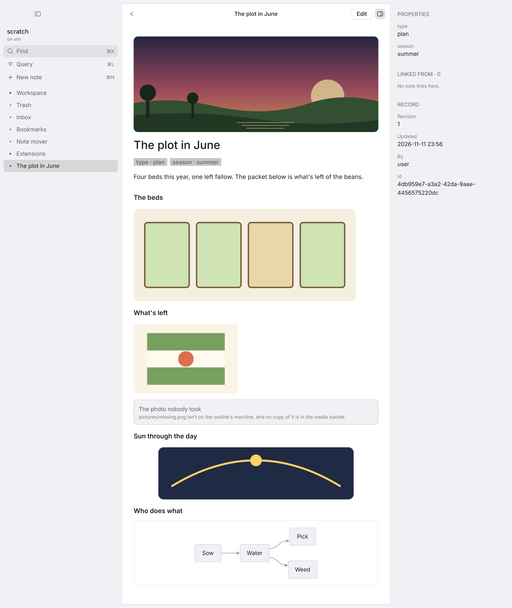

# ep0ch, native

ep0ch as a native window: tiles arranged by a layout (readers, and lists of whatever the service lists: the
outline's tree, a board's lanes, a question's matches, a note's links), drawn on the GPU with
[Rune](https://github.com/anomalyco/rune) and its `rune-kit` components. A screen is a note: an arrangement saved
here opens in the door, and one saved there opens here. It is a third client of the same outline, beside the door
and the Herdr console, and a thin host like every small client: it draws, and nothing in it reads Blockdown. It
ships no screen and no tile kind of its own: the ones every door ships are one extension's
([`extensions/screens`](../outliner/extensions/screens)), read the way any extension's are.





## Run it

```sh
cd packages/native
cargo run --release -- -- --ws pie                    # the window; any outline the usual rule names
cargo run --release -- -- --ws pie --machine float-2  # another machine's, over its forward
```

Everything after the second `--` names the outline as every client does: `--ws`, then `EP0CH_WS`, then the nearest
`.ep0ch`. That rule is the door's own, run once at launch (`resolve.ts`, with `bun` on the PATH or `EP0CH_BUN`);
after that the window speaks the host's socket itself and runs nothing else. `EP0CH_SOCKET` names a host
outright, as it does for the door, and is read by that same rule (a typed `--machine` wins over it): the window
never reads it itself.

Linux builds need `libxkbcommon-dev` and `libwayland-dev`; a machine with no GPU draws through lavapipe
(`mesa-vulkan-drivers`, `VK_ICD_FILENAMES=/usr/share/vulkan/icd.d/lvp_icd.json`).

## What Evan can do in it

| Do | How |
|---|---|
| Walk the outline | The tree tile: a press opens a note, a press on the open note folds or unfolds it |
| Open a screen | The bar's Screens (`bar.open scope=screens`, the toolbar's Screens): the desk, the navigator, the board, last callers, who's online, and every screen note the outline has. A row opens one (`screen.open name=`; `target=` is what it opens on, where its spec takes one) |
| Read a board | The board's lanes: the matches of a question, a lane a value of the property the screen names. `list.group by=<any property>` groups them by another, `list.layout layout=rows\|table\|lanes` arranges them another way, `list.sort by=<any property>` orders them; a card pressed opens beside |
| Narrow by what notes carry | The navigator: a facet's row, or a chip on any list, narrows that list's question (`facets.set key= value=`); the Matches tile beside it lists what is left, and the chip that says what it is narrowed by takes it back |
| See what changed | Last callers: the notes people and agents edited, newest first; a row opens its note beside |
| Arrange the window | `tile.split` (a second reader on the same note, or `kind=`), a tile's title dragged onto another tile (`tile.move to= side=`: a side of it, or its middle for a tab), a border dragged (`layout.resize`), `tile.close`, `tile.dock`, `dock.toggle`; `layout.undo` takes each back |
| Keep an arrangement | `screen.save name="Garden work"` writes it as a `[type::screen]` note; `screen.open name=` lays the window out as any screen the outline has; `screen.reset` puts it back as its screen has it. The window opens as it was left |
| Read what is wrong | A tile whose kind nobody draws, or that names a tile its screen hasn't, says so on the tile, in the service's words, and draws its spec as data |
| Read a note | Prose as Markdown, links that open, callouts, code; `::links`, `::fields`, `::view` and query-backed `::graph-table` as rows that open; figures as the primitives the service lowers them to (tiles, bars, a checklist, a table, a sparkline); a `::box` with its parts inside it. [How each component fares](docs/prim-coverage.md) |
| Press a button | A `::button` in a note is a button: an act line this window has runs here; one with steps or a script is run by the service, and what its script does in a window happens in this one. What it did is said under the button |
| See its pictures | The header image (`[layout::hero]`) as a band above the title; `[img::…]` lines (PNG, JPEG, SVG) where they stand; an ```svg fence as the picture its text is; a ```mermaid fence as a diagram |
| Follow anything | A link, a child, a backlink, a row in a component; `back` goes back |
| Do anything | The command bar: every action there is, by a word of its name or of what it does, with its keys beside it. A whole act line typed runs as written (`open id=…`) |
| Write | `edit` opens the note's Blockdown source; `edit.save` saves at the revision it read and keeps you in the editor; Esc leaves once everything is saved |
| Make, move, bin | `note.new` under the open one; `note.move` up, down, in, out; `note.trash` (the notice has Undo) |
| Find | The bar, with words: the service's search, under the actions that match |
| Query | The bar on a query: the views' grammar (`type=letter mail=waiting`), with the facets the matches carry as chips that narrow it; a header chip on a note, or a row of its properties, opens the query for it |
| See it change | An edit from the door, an agent or another machine redraws what's open |

**The keys are the actions' own.** Each action's row says its chords (`src/actions/*.rs`), and the key table, the
keycap on a button, the bar's rows and `actions` over the control socket all read the row. The defaults:

<!-- keys: the key table, as keys.rs reads it from the rows (a test keeps this true) -->
| Chord | Act line | Where | Does |
|---|---|---|---|
| `mod+[` | `back` | everywhere | back |
| `mod+n` | `note.new` | everywhere | a new note under the open one |
| `mod+backspace` | `note.trash` | tile | move the open note to the Trash |
| `alt+up` | `note.move step=up` | tile | move the note up |
| `alt+down` | `note.move step=down` | tile | move the note down |
| `alt+right` | `note.move step=in` | tile | move the note in, under the one above |
| `alt+left` | `note.move step=out` | tile | move the note out, after its parent |
| `mod+e` | `edit` | everywhere | edit the open note |
| `mod+s` | `edit.save` | everywhere | save |
| `mod+enter` | `edit.save` | draft | save, from the note's source |
| `escape` | `edit.close` | draft | leave the editor, when everything is saved |
| `mod+k` | `bar.open` | everywhere | open the bar on everything |
| `mod+l` | `bar.open scope=query` | everywhere | open the bar on a query |
| `escape` | `bar.close` | bar | put the bar away |
| `enter` | `bar.pick` | bar | pick the lit row |
| `down` | `bar.move by=1` | bar | the next row |
| `up` | `bar.move by=-1` | bar | the row before |
| `escape` | `notice.dismiss` | tile | dismiss the notice |
| `mod+d` | `tile.split` | everywhere | split this tile: a new one on its right |
| `mod+shift+d` | `tile.split dir=down` | everywhere | split this tile: a new one below |
| `mod+w` | `tile.close` | everywhere | close this tile |
| `mod+alt+left` | `tile.focus dir=left` | everywhere | the keys to the tile on the left |
| `mod+alt+right` | `tile.focus dir=right` | everywhere | the keys to the tile on the right |
| `mod+alt+up` | `tile.focus dir=up` | everywhere | the keys to the tile above |
| `mod+alt+down` | `tile.focus dir=down` | everywhere | the keys to the tile below |
| `mod+shift+b` | `dock.toggle side=left` | everywhere | show or hide the dock on the left |
| `mod+i` | `dock.toggle side=right` | everywhere | show or hide the dock on the right |
| `mod+alt+z` | `layout.undo` | everywhere | undo the last change to the arrangement |
| `mod+shift+s` | `screen.save` | everywhere | save the arrangement as its screen |
| `mod+shift+r` | `screen.reset` | everywhere | put the arrangement back as its screen has it |
<!-- /keys -->

`mod` is ⌘ on a Mac and Ctrl elsewhere. Where: a chord that is a tile's (`alt+up`) is the editor's own while a note
is being written, and Esc closes one thing at a time (the bar, then the editor, then the notice). Both docks resize
by their inner edge.

Capture comes first here too. Saving never ends editing, so a key typed around a save always has somewhere to
land. A save the service refuses (the note changed underneath) leaves every word in the editor and says why.
Leaving the editor with unsaved text is refused; another note opened meanwhile opens in a reader of its own beside
it (the layout's rule for a tile that holds an edit). Only Discard, by name, drops words.

## How it fits

```text
src/ (Rust, Rune)                                      the outline host
  shell.rs, bar.rs  draw any layout; a press, a drag, a drop runs an act line
  tiles/            a drawer an answer shape: page (a note), list (one list, whatever it is of)
  tiles/prim.rs     PRIMS: one builder a primitive type; the page drawer walks parts through it
  keys.rs           chord -> act line, by where the person is
  control.rs        an agent's act line, over native.sock
        │ an act line, whoever asks
        ▼
  actions/          the one dispatcher; one module a noun     ────────▶ update, create, move, delete, screens.save
  layout.rs         apply(layout, op) and place(layout, open): pure, the door's rules
  screen.rs         screens and tile kinds, as served         ◀───────  screens.list
  store.rs          one slot an ask; 64 watches a link        ◀───────  notes.page, lists.read
  client.rs         the socket                                ◀───────  queries.changed
  page.rs           the wire's shapes
  parts.rs          a page as primitives: its head and foot, the walk, the button a press names
  list.rs           the one virtualised list
  actline.rs        the act-line grammar
```

- **Every change is an act line through one dispatcher** (`App::act`, `actions/mod.rs`). A key, a press and an
  agent say the same thing (`note.trash`, `open id=…`); the dispatcher reads the line, types its arguments by the
  action's row, checks the actor against what the row touches, runs it and records the step. `App`'s state is
  private to `actions/`: a view reads everything and changes nothing except by a line.
- **An action describes itself** (`actions/row.rs`, outline-core's `ActionRow`): its name, summary, arguments,
  what it touches, its keys and its menu labels. Nothing restates them: a button names its act line and is
  labelled from the row.
- **The arrangement is a layout, and two functions decide about it** (`layout.rs`, no Rune and no socket).
  `apply(layout, op, ctx)` answers the layout after an operation or the refusal in words; `place(layout, open,
  ctx)` answers the tile an open lands in and why. Both are the door's (`desk/screen-layout.ts`,
  `desk/landing.ts`), rule for rule: the door's own answers are written down in `outline-core/fixtures/` and
  `src/tests/contract.rs` asks every row of `layout-contract.json` and `place-contract.json` here. Only an action
  issues an `Op`, and only `open` asks `place`.
- **A tile is a kind and a drawer** (`tiles/`). A kind's row is the service's (`screens.list`'s `kinds`, an
  extension's `tiles[]`): it names the drawer that draws it and the fields a tile of it starts with. There are two
  drawers, `page` and `list`; a drawer is handed a `TileCx` (the store to read, its spec, its kind's row, its own
  state) and speaks only by act lines (`cx.act`, `cx.emit`). The window keeps no catalogue of kinds and names
  none: a kind is found by any name its row answers to, and one with no drawer here is drawn as its spec. The
  shell (`shell.rs`) draws whatever tree the layout holds from the boxes the layout answers, so a split, a tab
  set, a dock, a flow and a float are one loop.
- **One list, whatever it is of** (`tiles/list.rs` over `list.rs`). A list tile asks `lists.read` for what its
  kind's row says it lists (`from`), with the parameters that source says it reads, each from what the person
  chose here, the tile's spec, then the row. The answer is rows that say what they show and the act line a pick
  runs, how they are arranged (`tree`, rows under their groups, `table`, `lanes`), a table's columns and the
  facets the listed notes carry. The window draws that, builds only the rows in view, and maps nothing: a tree,
  a board, a question's matches, a note's links and its properties are the same drawer. What a list is sorted or
  grouped by is a property's name, handed to the service as written.
- **A screen is data** (`screen.rs`): a row of `screens.list` (a `[type::screen]` note in either body, or an
  extension's), validated by the service. The window ships none: it opens on the one whose spec says `start`,
  else what its file kept. `screen.save` is the service's write (`screens.save`), so the note's form has one
  writer. The arrangement as it stands is kept in a file beside the control socket
  (`native-<outline>.layout.json`), written on each change.
- **Every read is an ask in the store** (`store.rs`): an outline, a wire action, its parameters, watched or not.
  Equal asks share a slot; a tile is a slot's user; a slot nobody shows keeps its answer and gives its watch to
  the next ask. `peek` lists the slots, who shows each and how much of the budget is held.
- **The service answers a note whole** (`notes.page`, outline-core's `note-page.ts`): title, chips, properties, the
  body as parts, and the notes above, under and linking to it. It walks the note as a published page does (one
  finder says which component a line starts, outline-core's `componentAt`) and asks the same questions; where a
  page writes HTML, it hands over data. A part says where it is written (its note, its line, its span in the
  note's text) and what to draw: a primitive of the catalogue (outline-core's `primitive.ts`), or prose as Markdown,
  a picture, or its lines as written when nobody has an answer for it.
- **A page is drawn by walking its parts through one registry** (`tiles/prim.rs`, `PRIMS`): an entry a primitive
  type, each its name, how it is drawn here and its builder. `parts.rs` makes the page's own head and foot
  primitives too (the title beside its edit, the chips as presses, the notes under it), so the page drawer does one
  thing: build each primitive by its type. `outline-core/fixtures/primitives.json` lists the types, and a test holds
  the registry to it; a type nobody builds is drawn as its data.
- **A press is `button.press`** (`actions/script.rs`), by a click, a key or an agent. An act line this window has
  an action for runs here, through the dispatcher, as whoever pressed. A button with steps or a script is the
  service's to run (`scripts.sequence`): the window registers as itself (`events.subscribe`), each act the run has
  for a window comes back as a call, the dispatcher runs it and the store answers (`scripts.answer`).
- **The window is a function of what's chosen and what's answered** (`actions/app.rs`). Each tile on screen wants
  what its drawer asks (a reader its note's page, a list its one list; a hidden tab asks nothing), and the bar its
  words; an answer lands in the slot of its own ask, or nowhere. There is no "is this answer still for what's on
  screen?" to get wrong.
- **Changes arrive as answers, not events to interpret.** A watched read (ADR 0004) is registered under one of the
  link's 64 keys: the service says which answer moved and the slot reads it by generation, when someone shows it.
  The window never works out what a change touches.
- **The tree is one list** (`lists.read from=children`, with the folders that are open): only what's unfolded is
  listed, and only the rows in view are built, so a large outline costs what's on screen.
- **The bar's sources are the service's too** (`bar.rs`). What a bar can list is what the list producers say of
  themselves (`lists.read from=sources`): the notes by the service's search, a question's matches, the screens.
  Their rows, facets and hint are one list answer each; the window's own source is its actions, read from their
  rows.
- **Pictures are parts too.** The page names each picture (its path, or an svg fence's own text) and how the note
  lays it out; the window reads a file's bytes with `media.read`, hands them to Rune's image cache to decode off
  the UI thread, and keeps only those of the pages its readers show. One the host can't read says so, in the host's words, where it
  would be.
- **It holds no grammar and names no property, kind or screen.** A tile's body is `rune-kit`'s `Markdown`, `Badge` and `Button`;
  `bar.rs` is its `Dialog` over the one list; every field is `keys.rs`'s; the toolbar is the screen's own list of
  act lines, each button labelled from its action's row. No drawer matches a figure's kind or a component's name:
  a figure with no primitive form shows the service's Markdown for it, and a component the service answers nothing
  for shows its source. Nothing is hidden.
- **`PROTOCOL` is the checkout's**: `build.rs` reads it from outline-core's `protocol.ts`, and a host on another
  number is refused with the side to update, as every client does.

## An agent in it

The window serves a control socket that speaks the door's control protocol (`control.rs`; the door's
`src/control.ts`): `native.sock` beside the outline's `door.sock`, or `--control <path>` after the second `--`
(`EP0CH_NATIVE_CONTROL`). So the door's own client reaches it:

```sh
ep0ch act --door native note.trash --as compost-agent   # the same action a key runs, recorded as the agent's
ep0ch peek --door native --json                         # {screen, focus, whereabouts, watches, tiles, layout, …, text}
ep0ch act --door native tile.split tile=reader dir=down # the layout's own rules say what an agent may arrange
ep0ch actions --door native                             # every action, as its row; every primitive type, as its entry
ep0ch act --door native button.press label="Sow the peas" --as compost-agent   # a note's button, pressed as the agent
```

- **An act is attributed.** Its write carries `mutation: {author: "agent", actorId}`, its step says who, and the
  toolbar's status line names the agent and the action.
- **An act takes nothing of the person's.** Not their keys, not the bar they have open or its lit row, not the
  editor: `edit`, `edit.save`, `edit.close`, `bar.close` and `notice.dismiss` are refused to an agent with why,
  `tile.focus` is the person's alone, and an agent's `open` lands without taking their keys: beside the reader
  when it holds unsaved text.
- **An agent arranges by the layout's rules.** `tile.split`, `tile.move`, `tile.close`, `tile.dock`,
  `layout.resize` are refused in the door's words when they would take the tile with the person's keys, resize
  the tile they type in, or undo a lock of theirs. A tile is addressed by name (`tile=reader2`); `peek` lists
  each with its kind, what it asks and what its drawer says of it, and the layout with every container's id.
- **An agent's `bar.open` lists the actions** for its words and opens nothing. A served source's rows (the
  notes, a query's matches, the screens) are the service's answer, which an act can't wait for: it is answered
  the rows the store holds now, whether that is an answer yet, and the `lists.read` request that lists them, so
  an agent asks the service the same thing the bar does. `list.pick`, `list.sort`, `list.group`, `list.layout`
  and `facets.set` take a list tile by name, and `peek` gives each list's rows with their act lines.
- **`peek` is state, not a frame:** a hidden window answers it. The element tree and a picture of a live window
  are not served yet; `--snap` and `--tree` draw headless, and a headless run serves no control socket.

## Check it

```sh
cargo test                          # the window over a stand-in link that answers by wire action
cargo test -- --ignored live        # the same window against a scratch outline host it starts (needs bun)
bun run check                       # resolve.ts, and scripts/native-forkable
```

`src/tests/` has one file a kind of test: the garden (what the window asks and does with the answers), the window
drawn and pressed, the parity table (every action by its chord, by its bar row pressed and by its act line, one
step record), the store (one slot an ask, the budget, what the service dropped), the fixtures (the act-line grammar
and the action rows against `outline-core/fixtures/`), the contract tables (every row of the door's layout and
place answers), the shell (one test a container kind, opens through the `open` action, a screen saved and broken),
the control socket, the lists (a board's lanes, the navigator's facets, a table, a long list, the shipped screens
opened from the bar's own row), the parts (every primitive type has a builder, a button runs here or is the service's,
a script's act is run and answered, and every component's own example is drawn: the test writes
[docs/prim-coverage.md](docs/prim-coverage.md)), and `one_owner.rs`, which scans the source for a second place that
binds a key, writes to the wire, lists rows, labels a button, issues an `Op`, places an open, draws a part, keeps a
kind or a screen, or maps an answer to rows. The stand-in host answers the screens and kinds from
`outline-core/fixtures/served-screens.json`, which the outliner's own test writes from a real service with the screens
extension installed.

`scripts/native-forkable` (run by `bun run check`) fails when `src/` names a shipped screen or kind, compiles a
screen in, or the extension names a drawer the window hasn't: what the window opens on is changed by forking the
extension or saving a screen note, never by building the window again.

The service's side is `packages/outliner/test/notes-page.test.ts`, `test/component-pages.test.ts` (each component's
example page, `outline-core/fixtures/component-pages.json`), `test/screens.test.ts`, `test/lists.test.ts` (one test a
list producer) and `test/screens-extension.test.ts` (the extension installed, forked and uninstalled); the block form
of a screen note is `packages/outline-core/test/screen-note.test.ts`. The shapes an extension's author writes against
(an action's row, a list's rows, the view primitives) are written out from the source as
`outline-core/fixtures/extension-types.d.ts`, kept true by `outline-core/test/extension-types.test.ts`.

Rune renders headless, so a change can be looked at without a display, on a scratch outline:

```sh
target/debug/ep0ch-native --snap out.png --scene bar --theme dark -- --ws scratch
target/debug/ep0ch-native --snap out.png -- --ws scratch --act steps.act
target/debug/ep0ch-native --tree tree.json -- --ws scratch
target/debug/ep0ch-native --snap out.png -- --ws scratch --screen garden-work   # opened on a screen the outline has
```


A scene is a file of act lines, `scenes/<name>.act`: `arrange`, `bar`, `edit`, `find`, `query`, `screens`, `board`,
`navigator`, `lastcall`, `table`, and `plan`, `figures`, `callouts` (which open notes of the showcase outline by
title), and `parts` (a note `bun scenes/parts.seed.ts <a scratch host's socket> <outline>` writes: figures, a box, a
live list, two buttons, the first pressed). `--act <file>` runs any file of them before the
first frame. A Rune `--script` taps by element key: a tile's parts are under `tile/<name>/` (`tile/reader/edit`,
`tile/reader/save`, `tile/reader/child/<id>`, `tile/reader/part/<n>` (a part's frame),
`tile/reader/part/<n>/view` (what it draws: its button), `tile/reader/part/<n>/<id>` (a row, by the note it opens),
`tile/reader/part/<n>/said`, `tile/reader/chip/<key>/<value>`, `tile/<name>/bar` its title, `tile/<name>/close`; in
a list `tile/<name>/row/<id>`, `tile/<name>/group/<group>`, `tile/<name>/lane/<group>`,
`tile/<name>/column/<column>`, `tile/<name>/facet/<key>/<value>` and `tile/<name>/narrowed/<key>/<value>`), a
toolbar button is
`tool/<its act line>`, a border `grip/<split id>/<n>`, and the bar's are `bar/field`, `bar/row/<source>/<key>`,
`bar/facet/<key>/<value>`.

## Not here yet

- Tiles: two drawers (`page`, `list`); no terminal tile, and a kind an extension draws with a script or a program
  is drawn as its spec. Folding a tile to a spine, zooming and floating one have no action here yet, though a
  screen that holds them is laid out and drawn.
- Lists are pressed, not walked: no cursor row moved by keys in a list tile, no `/` filter over its rows, no
  preview beside the picked row. Lanes share their tile's width (they don't scroll sideways), a card isn't dragged
  between lanes, and `grid` is drawn as rows. A tree lists at most a thousand rows and says when there are more.
- The board here is the matches of one question in lanes; the door's own board (a hub's views as lanes) and its
  desk (its named layouts) are still the door's, under the same names.
- A dock that slides over the layout is drawn where the layout says, without the door's tab strip along its edge;
  a drag shows no hint of where a tile will drop.
- A press inside a tile's body doesn't give it the keys by itself (its title, its tab or `tile.focus` does): Rune's
  focus isn't reconciled with the layout's yet (PROBES.md §1).
- One window: the arrangement is kept a file an outline.

- Editing is the whole note's source in one text area: no per-block outliner editing, completions or live drafts
  an agent can patch (`drafts.hold`).
- Comments, proposals, revisions and marks aren't shown.
- Figures with no primitive form yet (`uptime`, `activity`, `calendar`, `quadrant`, `flow`) show their lines as
  written, and a live `tabs` with nothing in it the service's Markdown; a view draws as rows whatever its layout; a
  `::use` shows its line (a template's body isn't walked yet); an extension's component shows its source; a
  property written in prose stays as written. A button with an empty slot (the part's `needs`) says what to write and doesn't ask for
  it; one whose look word isn't read says so and still runs; a button inside a list item draws as a part between the items. `docs/prim-coverage.md` has each.
- A list in a note has no filter, selection or preview pane; a row that copies or inserts is words. A heading
  style's glyph tracks aren't drawn.
- Pictures: text inside an SVG isn't drawn (Rune rasterises without fonts); a header image crops to its middle
  (`hero-focus`, `blur`, `tint`, `fade` and a title over it aren't read); artifacts and video stay as written;
  a view's card covers and pictures in properties aren't shown.
- Switching outlines from inside the window; the outline is named when it starts.
- A connection keeps at most 64 watched answers (the host's bound): the page, the bar's query and one per unfolded
  folder. Past the budget an answer is read unwatched and registered when a key is free (`peek` says which).
- Keys are the rows' defaults: a screen's own keys and the person's `keybindings.json` aren't read yet.
- Extensions aren't installed or uninstalled from this window's bar yet (the door's bar and `ep0ch act
  extensions.install id=screens` do it); with the screens extension uninstalled the window says there is no screen
  to open on, and opens when it is back.
- After its own write the window reads what it shows at once rather than waiting for the watch to say so.
- The bar's list bounds itself to seven rows (`list::bounded`): `rune-kit`'s `Dialog` doesn't bound a scroll view in its body.
- Rune is pre-release and pinned by rev in `Cargo.toml`. Windows builds also need Rune's `wgpu-hal` patch
  (its README, "Add it"), and the socket is a Unix one.
