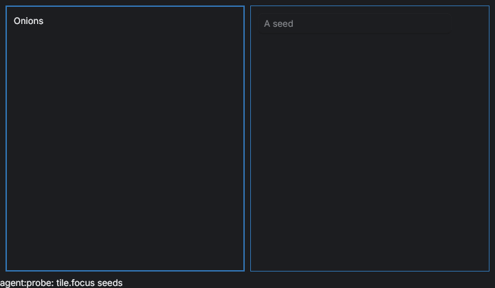
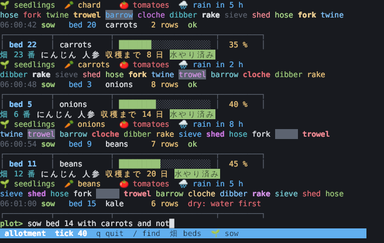
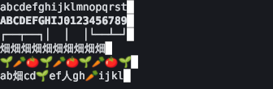
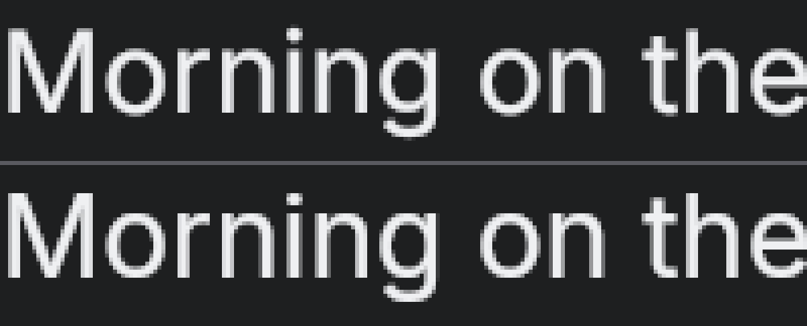

# Native ep0ch: what the probes found

**Every question [DESIGN.md](DESIGN.md) left "not verified" now has an answer: seven from running code, four from
reading it.** Six are a plain yes. The live window is yes while it draws and no while it is hidden; the door's pty host
is no. Each no names what it changes. The probes are a crate of their own, [`../probes/`](../probes), on the app's Rune
rev; nothing in it is a dependency of the app. The generated contract tables, what the door's layout answers written
down for native to be tested against, are [below](#the-contract-tables).

| # | Question | Answer | Evidence | What it changes in DESIGN.md |
|---|---|---|---|---|
| 1 | Can focus be set from code, so Rune's focus follows `Layout.focus`? | **Yes.** `Tx::focus(key, ring)` from any handler, `update` or `poll`. One reconciler in `poll` does both directions. | `tests/focus.rs`, 12 tests | §4 "Which tile has focus" gains the reconciler and three rules ([1](#1-focus)). |
| 2 | Can a kit `TextInput` or `TextArea` be wrapped so the key table sees chords first, the field gets text second, the rest goes up? | **Yes,** by one closure given to every field's `on_key`. "Up" is the window's `on_key` only. | `tests/field.rs`, 13 tests | §4 "How a field passes keys" stands. Two additions: Return in a note's source, and where Up and Down go ([2](#2-the-field-adapter)). |
| 3 | Can a drag handler read other tiles' rects for a drop side, and can dividers be dragged with `on_drag`? | **Yes** to both. The view reads `Cx::layout` and the handler captures the rects. | `tests/drag.rs`, 9 tests | §7 Mouse stands as written ([3](#3-drags)). |
| 4 | Can a live window return its element tree and a PNG, and run an act line from another thread? | **Yes while it draws. No while it is hidden:** then acts and state answer, the tree and the picture do not. Covered and minimised were not run. | `tests/live_window.rs`, `src/bin/probe-live.rs` | §5 Control: `peek`'s facts come from state; its tree and `snap` need a drawn frame ([4](#4-the-live-window)). |
| 5 | Can N dynamic tiles be drawn from a `HashMap<TileId, TileUi>` without the kit's `fn(&mut S)` accessors, keys namespaced `tile/<name>/…`? | **Yes.** Fields, buttons and a `TabStrip`'s handlers take a tile id. `SplitView` panes, kit `Tree`, `Table` and a strip's drag state do not. | `tests/tiles.rs`, 5 tests; `src/accessors.rs`, 7 doctests | §7 "Typed handlers" stands. One addition: one `TabDragState` for the window ([5](#5-tiles-from-a-map)). |
| 6 | Does a per-tile `memo(tile.id, version)` skip an unchanged tile's view? | **Yes: zero draws.** It takes about a millisecond off a 4 to 5 ms frame; the rest is Rune's own work per mounted element. | `tests/memo.rs`, 8 tests | §5 Frame cost stands. The version is everything the drawer reads ([6](#6-the-per-tile-memo)). |
| 7 | Terminal: what does a grid cost per frame, and do wide cells stay on the column grid? | **0.4 to 3.8 ms a frame** as text rows. **One text per row drifts; rows cut at wide cells do not.** | `tests/terminal.rs`, 9 tests | W8: the `pty` drawer draws rows cut at wide cells. No `Pixels` image ([7](#7-the-terminal)). As built: 1.5 to 2.3 ms a frame for the whole window. |
| 8 | What does the door's pty host protocol give a second client? | **Nothing: there is no second client.** A second hello takes the host and the first daemon is let go. | read: `door/src/session/pty-host.ts` | §7 "Pty hosts" and W8 gain a host protocol change, or native keeps a host of its own ([8](#8-the-doors-pty-host)). As built: neither. W8's programs are herdr-core's, which has viewers ([15](#15-herdr-core-w8)). |
| 9 | Does libghostty-vt have a usable Rust binding? | **Yes, on crates.io:** `libghostty-vt` 0.2.2. It builds Ghostty's source with Zig. Not built here. | `cargo search`, `cargo info`; the crate's source read | W8's feature names it; a machine that builds the feature needs Zig, or a library built elsewhere ([9](#9-libghostty-vt)). As built: not used. W8's emulator is alacritty's, in Rust, through Moonframe. |
| 10 | What shape does `drafts.answer` have today? | **`{requestId, clientId, answer}` or `error`.** A read answers the holder's text. A patch is placed by the holder, which answers `applied`, never ranges. | read: `outliner/src/draft-patch.ts`, `server.ts`, `door/src/socket.ts` | §3 `draft.patch` for a native holder is a new ask kind beside today's three ([10](#10-draftsanswer)). |
| 11 | Does `replaces` give an extension kind a bare name? | **Yes, for a name no live kind has.** The old name opens the kind that replaces it, and the tile saves under the full name. | read: `door/src/desk/tile-kinds.ts`, `outliner/src/extension-manifest.ts` | §2 Kinds stands if the door's literal goes first. Saved screens name `<extension>.<kind>` ([11](#11-replaces)). |

Three more things turned up, two of them bugs in the spike. They are reported and not fixed
([Found on the way](#found-on-the-way)). W5 added one more answer, from building on it: how Rune's text editing
carried a block editor ([12](#12-the-block-editor-w5)). W7 answered the one about several windows the same way
([13](#13-several-windows-w7)). W6 added what a selection in drawn text gives a window, and what a list inside a
list's row does ([14](#14-selections-and-what-else-w6-met)). W8 added what herdr-core gives a terminal tile, read
and spoken to a stand-in but never run ([15](#15-herdr-core-w8)). H3 added what a Mac's title bar takes of the toolbar, read from Rune and run on
a headless runtime, not on a Mac ([17](#17-a-macs-title-bar-and-what-else-the-first-run-by-hand-met-h3)). R0 moved
the Rune pin from `cb0c118` to `a5360a6` and ran every probe again on it: the answers above hold, and what changed
for the window is in [18](#18-rune-at-a5360a6-r0).

## How to run

```sh
cd packages/native/probes
export CARGO_TARGET_DIR=<the app's target folder>     # shared with ../, already warm
export VK_ICD_FILENAMES=/usr/share/vulkan/icd.d/lvp_icd.json   # no GPU: lavapipe
cargo test                                              # every probe but the live window
cargo test --test live_window -- --ignored --nocapture  # needs Xvfb and libxkbcommon-x11
cargo test --release --test terminal measure -- --nocapture --test-threads 1
cargo test --release --test memo measure -- --nocapture --test-threads 1
```

- **Fonts:** the terminal probe asks fontconfig (`fc-match`) for a monospace, a CJK and a colour emoji face.
- **Pictures:** `EP0CH_PROBE_SNAPS=<folder>` makes the terminal tests write what each way drew.
- **Numbers below** are release builds on four cores with no GPU. The renderer's times are lavapipe's, so they bound
  nothing on a laptop; the CPU's times are the ones to read.
- **A second run** of the memo and terminal measurements, with other builds busy on the same four cores, took up to
  1.5 times as long (the largest split grid 5.6 ms a frame, not 3.8). Element counts, tiles drawn and the order of
  the three ways were the same. Read the tables as ratios.

## 1. Focus

**Rune's focus follows the layout's, both ways, through one function in `poll`.**

- **Layout to Rune:** `Tx::focus("tile/<name>", ring)`. It lands in the same frame, with or without a ring.
- **Rune to layout:** `Tx::focused()` in `poll` names the focused element by its own key. When it moved without being
  asked, that is the person, and it becomes `Op::Focus`.
- **A field has the keys** when its `TextEdit::focused` is true; the runtime keeps that flag.

Three rules the reconciler needs, each a test:

- **Ask once per change, never every frame.** A reconciler that compares `Tx::focused` with the tile's key takes the
  keys back from a field: a kit field's focused element is keyed `input`, with no tile in it.
  (`a_reconciler_that_only_knows_tiles_takes_the_keys_back_from_a_field`)
- **Ignore your own echo.** Rune's focus is read one frame after it moves, so the move the reconciler asked for comes
  back looking like the person's.
- **Ask again when what is shown changes.** `Tx::focus` on a key nothing shows does nothing and says nothing.

Two facts about presses and Tab:

- **A press inside a tile does not reach the tile's `on_press`** when a row or a field took it. The layout hears
  through Rune's focus instead: an element with `El::on_key` takes focus from any press inside it.
- **Tab is Rune's unless the tile takes it.** With no `El::on_key` on the tile, Tab moves Rune's focus and no handler
  runs. So each tile's root carries `on_key`, which is where the key table sits for a focused tile.

**DESIGN.md §4:** "Which tile has focus" keeps its owner. Add: `keys.rs` holds the reconciler, the only caller of
`Tx::focus`; each tile's root has `focusable` and `on_key`; `one_owner.rs` also forbids `Tx::focus` outside it.

## 2. The field adapter

**One closure, given to `TextInput::on_key` and `TextArea::on_key` alike, puts the table first.**

Rune's order for a key while a field has focus, as the tests saw it:

1. The field's `on_key` (Rune's `on_input_key`): the adapter. True takes the key.
2. The editor: text, arrows, select all, undo, paste.
3. The window's `on_key`, with `Tx::focused()` naming the field.

- **The tile's `El::on_key` is skipped** for a field's keys. "Unhandled up" means the window's `on_key`, nothing else.
- **The table beats the editor** for a chord both know (`mod+z` bound in the field layer runs the row, not undo).
- **Return, Escape and Tab reach the adapter before** submit, modal dismiss and focus navigation.
- **Up and Down stop at a single-line field's editor.** A list under the bar's field gets them only as rows of the
  table's field layer.
- **A chord sequence (`ctrl+w q`) is the table's to hold.** Rune's `Chord` is one chord; the second key is taken
  before it types.
- **Plain Return in a kit `TextArea` is "submit", not a new line.** With no `on_submit` it goes to the default button
  and types nothing; Shift+Return types the line. The adapter types it for a note's source (`TextEdit::insert`).

**DESIGN.md §4:** "table first, text second, unhandled up" stands. Add to the adapter: a `lines` field types Return
itself. W1's bar lists Up, Down and Return as field-layer rows.

**As built (W5):** a block's source is a `lines` field, and Return types a line there. While the list that completes
a word is open, the person is one layer further in (`complete`, over `draft`): Up, Down, Tab, Return and Escape are
that layer's rows, asked before the draft's and before the editor, so the list is driven from the field without
taking its focus. A list with nothing to choose from (the service's word alone) is the layer `said`: Escape only. A row that says Return is still the field's (`enter`, nothing chosen yet) gets a line typed.

## 3. Drags

**A handler never gets a `Cx`, so the view reads the rects and hands them over.**

- **Rects:** `Cx::layout("tile/<name>")` in the view, captured by the title's `on_drag`. The view re-runs when a rect
  it read moves, so the handler always holds the current ones.
- **The pointer:** `Drag::window_point()`, in window points. The press keeps the drag when the pointer leaves the
  title, the tile or the row.
- **The drop:** the tile under the point and its nearest side (a centre third is `center`) become
  `tile.move <tile> to=<tile> side=<side>`. A drop on its own tile, or outside every tile, is nothing.
- **Dividers:** `on_drag` with `Drag::dx` measured from the press, so each move is the whole change. Weights are
  clamped by the handler.
- **Cancel:** Escape arrives as `Phase::Up` with `Drag::cancelled()`; the handler puts the weights back.
- **`El::on_layout` into state** gives the same rects and the same number of view runs. **`Tx::element_at`** answers
  after the handler and without a rect: it can name a tile, not choose a side.

**Cost:** six pointer moves on a divider ran the view 14 times, because the view reads the rects it just changed. With
the per-tile memo those runs draw no tile ([6](#6-the-per-tile-memo)).

**DESIGN.md §7 Mouse:** stands. The rects come from `Cx::layout` in `shell.rs`.

**As built (H2):** the handler captures no rects at all. It says the cell the pointer is over as an act line
(`layout.carry col= row= tile=`, only when the cell changes) and that it let go (`layout.drop`), and the model asks
the layout's drop rule with the boxes the layout itself answers, so what is drawn while a title is held and where it
lands are one answer (`layout/drop.rs`, the door's `drop.ts` by `drop-contract.json`). What held up, run headless:

- **Escape during a drag never reaches a key handler.** Rune ends the drag itself (`Phase::Up`, `cancelled()`):
  the shell says `layout.drop cancel=true` there. The same act is the `moving` layer's Escape row, for a hold made
  by an act line (a scene), where no drag is under way.
- **The pointer is followed outside the window** (`Drag::window_point` goes negative, or past the window's size):
  that is how a tile is let go "outside". The headless runtime does the same; a real window's capture was not run.
- **`Drag::screen_point` is `None` headless**, so a drop at a chosen place in another window of the run (which
  needs both windows' frames on the desktop, `WindowHandle::placement`) was not built: a torn window's tile goes
  back into the window it came from by `tile.return`, where the layout takes a new tile.
- **A press in a tile's body already gave it the keys**, on bare ground, on a list's row and on a note's words
  (`a_press_in_a_tile_s_body_gives_it_the_keys`, green before any change): `keys::follow` hears Rune's focus land
  in the tile. The README had said it did not. What `follow` cannot hear is a press whose focus names no tile (a
  kit part keyed by the kit) or that leaves Rune's focus where it was; a drawer's press now says its tile by the
  same act (`App::pressed_in`). Whether a Mac's window differs was not run.

## 4. The live window

**A real window on a real X server answered `act`, `peek` and `snap` over a Unix socket.**



| Verb | How | Median, from the client's side |
|---|---|---|
| `act <line>` | `AppHandle::update(move \|s, tx\| …)` from the socket's thread; the answer comes back on a channel | 0.11 ms |
| `peek` | `App::on_frame_drawn(\|rt: &Runtime<S>\| rt.elements())` after the next drawn frame | 3.6 ms |
| `snap <png>` | a `Compositor` draws the frame once more into an `Offscreen` and reads it back | 10.8 ms (720 by 420) |

What `AppHandle::update` offers:

- **It is `Send` and `Clone`,** and takes `FnOnce(&mut S, &mut Tx) + Send`. It runs on the UI thread, in call order.
- **It runs while no window shows.** A hidden window still acted and answered its state.
- **It returns nothing.** The closure sends its outcome over a channel.
- **It takes no focus and no pointer.** The probe's dispatcher refused the one line that asked for focus as an agent.
- **`update_if`** is the same for a read: return false and nothing redraws.

**The no:** a hidden window draws no frame, so `on_frame_drawn` and the compositor never run. `peek`'s tree and `snap`
then wait for nothing; the probe refuses after three seconds and says why. Only `hide` was run: whether a covered or
minimised window draws is the platform's, and the same refusal covers it without knowing which.

**DESIGN.md §5 Control:**

- `peek`'s `{screen, focus, whereabouts, watches, tiles}` come from state through `update_if`, always.
- The element tree and `snap` come from a drawn frame. For a window that is not showing, they refuse with the reason;
  `--headless` stays the way to draw without one.
- `control.rs` owns a `Compositor` (it draws Rune's default frame) and the `on_frame_drawn` hook.

## 5. Tiles from a map

**Opened, used and closed while the window ran, each tile's state found by id.**

- **Take a tile id (closures):** `TextInput`, `TextArea`, `TextField`, `Button`, and a `TabStrip`'s `on_select`,
  `on_close` and `on_reorder`.
- **Take only a field named at compile time (function pointers):** `SplitView::sidebar` and `inspector`
  (`PaneState`), kit `Tree` (`TreeModel`), `Table` (`TableState`), `TabStrip::drag_state`. `src/accessors.rs` has a
  doctest that compiles and one that does not for the panes, the tree and the drag state; `Table::new` has the
  tree's signature.
- **Tab drags still work:** every strip shares one `TabDragState` in the window's state. A drag in one strip reordered
  only that strip.
- **Lists are the app's own:** `El::virtual_rows`, the cursor in `TileUi`. Rows outside the list's window are not
  built.

Keys:

- **`tile/<name>/…` keys are unique and `Runtime::find` resolves them,** slashes and all.
- **The kit's own part keys repeat** in every tile (`input`, `value`): never look one up alone.
- **A tab's element is keyed `t-<id>`,** so a tab's id must be unique in the window. A tile name is.
- **A memo's id becomes its root element's key:** name it `tile/<name>/body`.

**DESIGN.md §7 "Typed handlers, windows":** stands. Add: one `TabDragState` per window.

## 6. The per-tile memo

**An unchanged tile is not drawn. The frame still costs what its mounted elements cost.**

Eight tiles of 150 rows, release build:

| Rows built | Memo | Elements | One tile changed | Only the status line changed | Tiles drawn |
|---|---|---|---|---|---|
| all | no | 2,475 | 4.79 ms | 4.34 ms | 8 and 8 |
| all | yes | 2,475 | 3.71 ms | 3.13 ms | 1 and 0 |
| shown | no | 1,563 | 3.80 ms | 3.54 ms | 8 and 8 |
| shown | yes | 1,563 | 3.70 ms | 3.37 ms | 1 and 0 |

- **The saving is the view build:** about 1 ms here. The 3 ms floor is layout and painting of every mounted element,
  which a memo does not skip. Fewer mounted elements is the other lever, and lists already virtualize.
- **The version is everything the drawer reads.** With the cursor left out, the state changed and the row kept its old
  mark.
- **A `TextEdit` in the version is enough for a field:** typing drew one tile per key and the field kept the keys.
- **Handlers in a reused tile still run.** They hold what they captured at build, so they capture ids.
- **A divider drag draws no tile:** layout reflows a reused subtree.
- **A tile with a kit field draws twice at first.** The kit reads its own size while it builds; Rune tracks that read.

**DESIGN.md §5 Frame cost:** stands as written.

## 7. The terminal

**Draw each row as mono text, cut only where a wide character sits.**



Three ways to draw the same grid, fed a canned log that scrolls (every row changes) or a prompt (one row changes):

- **rich:** one mono text per row, a span per run of colour.
- **split:** each stretch of one-column cells is one mono text of a fixed width; each wide character sits in a box two
  cells wide; each run of background is a rect behind them.
- **image:** the grid rasterised on the CPU (swash) into one `Pixels` image.

CPU milliseconds per frame, median of forty, release build. "paint" is the image's cell blit and copy; "frame" is
`Runtime::frame`.

| Grid | Scale | Way | Scroll: paint + frame | Prompt: paint + frame | Elements |
|---|---|---|---|---|---|
| 80 by 24 | 1 | rich | 0.38 | 0.38 | 26 |
| 80 by 24 | 1 | split | 1.20 | 0.51 | 306 |
| 80 by 24 | 1 | image | 0.39 + 0.15 | 0.09 + 0.14 | 2 |
| 80 by 24 | 2 | rich | 0.56 | 0.39 | 26 |
| 80 by 24 | 2 | split | 1.15 | 0.56 | 306 |
| 80 by 24 | 2 | image | 1.45 + 0.43 | 0.47 + 0.41 | 2 |
| 200 by 60 | 1 | rich | 1.27 | 1.10 | 62 |
| 200 by 60 | 1 | split | 3.09 | 1.34 | 769 |
| 200 by 60 | 1 | image | 1.92 + 0.63 | 0.64 + 0.63 | 2 |
| 200 by 60 | 2 | rich | 1.49 | 1.21 | 62 |
| 200 by 60 | 2 | split | 3.76 | 1.47 | 769 |
| 200 by 60 | 2 | image | 15.29 + 3.41 | 4.33 + 3.50 | 2 |

Lavapipe then took 3 to 8 ms to draw an 80 by 24 frame and 12 to 39 ms for 200 by 60 as text (22 to 108 ms as an
image). That is a software rasteriser on four cores, not a GPU.

Do wide cells stay on the column grid? A mark was put at column 20 after twenty columns of each kind:

| Way | Bold | Box drawing | Ten CJK | Ten emoji | Mixed line |
|---|---|---|---|---|---|
| rich | on it | on it | **3.45 cells early** | **0.64 cells late** | **0.51 cells early** |
| split | on it | on it | on it | on it | on it |
| image | on it | on it | on it | on it | on it |



- **Rich drifts** because a fallback face sets each wide character at its own advance (13 pt for a 7.83 pt cell), and
  nothing in a text run pulls it back.
- **Rich also rounds backgrounds:** a span's `bg` is an inline-code chip, and a status row's ground stops at its text.
- **Split costs 2 to 3 times rich and stays under 4 ms** for a full 200 by 60 screen at scale 2.
- **The image is cheapest small and dearest large:** `Pixels::set` takes a whole new frame each time, 26 MB at
  200 by 60 and scale 2.
- **Commit a frame with `tx.instant()`.** Without it Rune eases what the commit replaced: one frame after a scroll,
  445 elements of an 80 by 24 grid were still leaving, moving or fading, and the picture showed old and new rows
  together.
- **A row's memo version is the row's cells:** typing at a prompt drew one row of twenty-four.

**DESIGN.md W8:** `tiles/pty.rs` draws rows cut at wide cells, each in `memo(row, cells)`, backgrounds as rects,
commits instant. No `Pixels` path. "Redraw cost recorded" is this table; W8 records it again on the laptop's GPU.

**As built (W8).** `tiles/pty.rs` is the split way: `pty::cut` cuts a row where a wide character sits, a piece is
a box as wide as its cells, a ground is a rect behind them, a row is a memo over its own cells and the cursor, and
the grid lands at once (`El::instant_changes` on the grid, so the window's other motion keeps its own).

- **The face is the platform's monospace** (`Family::SystemMono`: fontconfig's `monospace` here). The kit's mono
  slot is the sans face until an app names one ([Found on the way](#found-on-the-way)), and a row set in a
  proportional face stays on its columns only at the cuts: the first picture of the scene showed a ground two
  columns off its words.
- **A cell is measured, not assumed:** the face's advance over two hundred characters (`rune::text::measure`),
  once a size.

What a frame of the whole window costs with a terminal tile in it (the garden's tree, reader and lists beside it),
CPU milliseconds in `Runtime::frame`, median of forty, release build, the same four cores and no GPU:

| Grid | Scroll (every row changes) | Prompt (one row changes) | Nothing new | Row elements | All elements |
|---|---|---|---|---|---|
| 80 by 24 | 1.49 | 1.69 | 0.57 | 118 | 475 |
| 200 by 60 | 2.30 | 2.17 | 1.10 | 298 | 763 |

`cargo test --release measure_a_terminal_s_frame -- --ignored --nocapture` (`src/tests/terminal.rs`). A debug
build took 6 to 9 ms for the same.

- **It is inside the probe's bound** (1.2 ms and 3.1 ms for the grid alone, split): the window's frame with a
  full terminal scrolling is 1.5 to 2.3 ms.
- **A prompt costs what a scroll costs here.** The row memo saves building a row, and that is not where this
  frame goes: the grid is copied out of the run's registry and every row hashed each time the tile is drawn, and
  the tile's own memo is versioned by the program's change count, so its strip and its rows' boxes are laid out
  again. Not profiled further: both are under a quarter of a 60 Hz frame.
- **Not measured:** a real GPU, a program that prints faster than frames are drawn (the emulator's thread drains
  what waits and publishes one screen), and input latency through a real pty.

**Since R0, Rune has this part.** At `a5360a6` `rune::grid(cols, cell_w, cell_h, rows)` is a terminal's screen as
one element: a row's narrow cells as one shaped line, wide cells pinned to their columns, grounds and selection as
runs, a row shaped once while the app hands back the same `Rc<GridRow>`, and a screen reader's caret
(`El::grid_caret`). That is the split way above, made by Rune (its changelog gives 200 by 60 at 2.5 ms a full
redraw and 0.4 ms for one row changed, headless). Read, not run here: `tiles/pty.rs` still builds rows cut at wide
cells, and moving it onto `grid` is a wave of its own.

## 8. The door's pty host

**The protocol has one client by design: the daemon. A second hello takes the host from the first.**

Read, not run: `packages/door/src/session/pty-host.ts`, `src/desk/pty-backend.ts`, `src/session/protocol.ts`.

- **Where:** `pty.sock` in the session's outline folder, mode 0600. `HOST_PROTOCOL = 1`.
- **A frame:** one byte of type, four of id (the program's, big-endian), four of length, then the payload: raw bytes
  for `w`, `r` and `o`, JSON for the rest.
- **Client to host:** `h` hello, `s` spawn (`{key, argv, cwd, env, cols, rows, meta}`), `w` write, `z` resize,
  `k` kill, `f` forget, `m` meta, `q` end everything.
- **Host to client after `h`:** `l` the list (`{proto, pid, ptys}`), one `r` per program (its replay: the last 1 MiB
  it wrote, from a whole line), `y` ready. Then live: `o` output, `p` spawned (pid), `e` error, `x` exit.
- **The byte stream is the program's own output,** escape sequences and all. The client parses it; the door feeds
  `@xterm/headless`. A later `r` means the client fell behind: its emulator starts over from it.
- **One size per program:** `z` resizes the pty for everyone.

What a second client gets:

- **With a hello:** it becomes the daemon. The host drops the first connection (`daemon.destroy()`), and the door's
  daemon marks every program gone (exit 129).
- **Without one:** nothing. It is taken for a probe.
- **The door's session socket is no way round it.** That protocol does take several clients, a read-only `watch`
  among them, but its `output` is the door's whole painted screen for that client's size, not a tile's program.

opencode's process daemon (`packages/process-daemon/SPEC.md`, protocol 8) is the shape the door's host lacks:

- **`subscribe {id, offset, attachment_id, role, takeover}`** answers `Attached` with a replay from an absolute byte
  offset, then tagged binary output frames (`start`, `end`, bytes).
- **One controller, any number of observers.** Promotion, resize and input are one ordered command; every resize
  publishes a VT checkpoint before the next output.
- **The daemon parses with libghostty** and serves `snapshot` and `read_rows`, so a late client needs no replay.

**As built (W8):** native starts no host of that protocol and `HOST_PROTOCOL` is untouched. Its programs are kept
by herdr-core, which is built for more than one viewer ([15](#15-herdr-core-w8)). The door and native still share
no program through the door's host.

**DESIGN.md §7 "Pty hosts: one, the door's pty host protocol":** true for native alone, false for sharing.

- **Native by itself:** it starts a host for its own state folder and is that host's one daemon. The protocol works
  as it is, and "detaches, returns" holds.
- **Door and native on one session's programs:** the host needs viewers. W8 gains door work: `HOST_PROTOCOL` 2 with a
  role on `h`, output fanned out to every viewer, one controller for `w` and `z`. Until then a program belongs to
  whichever door started it.

## 9. libghostty-vt

**There is a maintained binding on crates.io. It needs Zig to build.**

| Crate | Version | From | Notes |
|---|---|---|---|
| `libghostty-vt`, `libghostty-vt-sys` | 0.2.2 | `uzaaft/libghostty-rs`, MIT or Apache-2.0, Rust 1.90 | about 203,000 downloads; updated Sep 28 |
| `ghostty-vt`, `ghostty-vt-sys` | 0.8.0+ghostty.1.4.0 | `prabirshrestha/gpui-cn`, Apache-2.0, Rust 1.96 | adapted from the first; its README says macOS is the only supported runtime |

- **What the safe crate has:** `Terminal::vt_write`, `resize`, `on_pty_write` (the answers a program asked for), and a
  `RenderState` with per-row dirty flags, cells with style, colours and `CellWide` (narrow, wide, tail). That is the
  grid `src/grid.rs` stands in for, with the dirty rows a per-row memo wants.
- **How it builds:** the `-sys` crate fetches a pinned Ghostty commit and builds `libghostty-vt.a` with Zig in
  `build.rs`. Bindings are checked in, so no bindgen. First build needs the network, or `GHOSTTY_SOURCE_DIR` and
  `GHOSTTY_ZIG_SYSTEM_DIR`.
- **Not built here:** this machine has no Zig, and the crate is not a dependency of anything in the repository.
- **opencode does not use it:** it checks in its own FFI declarations and builds Ghostty at its own pinned revision
  with Zig 0.16.

- **Without Zig, two ways, neither tried:** `libghostty-vt-sys` has `link-dynamic` and `pkg-config` features for a
  library already on the machine. `ghostty-vt-rs-sys` 0.3.0 (`nklmilojevic/ghostty-vt-rs`, MIT) says it ships prebuilt
  static libraries; it is raw FFI, and which platforms it covers was not read.

**DESIGN.md W8:** the `pty` cargo feature depends on `libghostty-vt`. A machine that builds the feature needs Zig, or
one of the two ways above once W8 has tried it; without the feature nothing changes.

**As built (W8):** the feature does not depend on it. The emulator is `alacritty_terminal`, in Rust, through
Moonframe's `moonframe-terminal` taken with `default-features = false, features = ["alacritty"]`; its `ghostty`
feature (which is this crate, and Zig) is never turned on, on any machine. No Zig was installed or needed.

## 10. `drafts.answer`

**The holder answers an ask of the service's; it never sends a buffer by itself. Read, not run.**

- **The ask:** an event `{domain: "draft", action: "draft.<kind>", blockId, draft}`. `draft` holds the ask, a
  `requestId`, the `holdId` and `targetClientId`, the holder's client id. Three kinds: `read`, `patch`, `revert`.
- **The answer:** the request `drafts.answer {requestId, clientId, answer}`, or `error` in place of `answer`. The
  service says `{accepted: true}`. It is taken at once, never queued behind the request that waits for it.
- **`answer` by kind:**
  - `read`: `{text, revision}`, the draft as the holder has it now.
  - `patch`: `{applied: true, inverse?: {before, text, revision}}` or `{applied: false, reason}`.
  - `revert`: `{reverted}`.
- **Who places a patch:** the holder. A `patch` ask carries `patches` (each `{observed, replacement, range?}`, the
  range a hint) and `revision`; the door finds the spans in its own buffer.
- **Time:** 2.5 seconds (`DRAFT_HOLDER_TIMEOUT_MS`). A holder that is late keeps its hold and is asked only reverts
  after that; patches fail into proposals.
- **A wrong `clientId`, or a `requestId` nothing waits for, is refused.**

**DESIGN.md §3:** "the holder sends its buffer in `drafts.answer`, the host places the patch and returns resolved
ranges" is half there. `read` already gives the host the buffer. Nothing hands ranges back today: that ask is W5's
wire change, and the door's `patch` can stay as it is.

**As built (W5):** one more ask kind, `place`, and one more thing a holder may answer.

- **A holder that places nothing says so by what it answers.** Asked to `patch` or `revert`, the native window
  answers `{applied: false, reason, draft}` (`{reverted: false, draft}`): its draft as it stands, `{text, revision,
  version, cursor, anchor, busy}`, offsets in UTF-16. No flag on the hold and no client kind is read: the door
  answers `applied` as before and is asked nothing more.
- **The service places it** (`outliner/src/draft-place.ts`, wrapped round the router's one way of asking a holder):
  it decides with outline-core's `placeDraftPatch`, the same function the door's `Draft.applyPatch` now calls, and
  sends `place {patchId, version, spans, mutation, did, standsOn?, revert?}`. A span is `{start, end, replacement,
  caret?}`; `caret` says what it does to an offset beside it (`stays`: an answer under its ask; `apart`: a
  paragraph added at the very end).
- **`version` is the compare.** The holder takes the spans only while its text is the one they were found in; typed
  in since, it answers with its draft again and the service places the patch once more (three tries).
- **A revert is placed the same way:** the service keeps what each placed patch wrote (`patchedSpans`) and finds
  the spans that take it back (`revertSpans`, the door's own compare, moved to outline-core).
- **What the person is told** is the service's word too: `did`, from outline-core's `patchDid`, which the door's
  session calls for the same sentence.
- **Not asked of a native holder:** an ask's progress (`replyGroup`'s undo bookkeeping is the door's own history),
  and a proposal's dismiss line: both reach it as an ordinary `place`.

## 11. `replaces`

**An extension's kind is named `<extension id>.<kind>`. `replaces` lets a retired name open it. Read, not run.**

- **In the manifest:** `tiles[].replaces`, up to eight names, "full names, as a layout saved them". It rides on the
  tile's row in `extensions.list`.
- **In the door:** `registerTileKind` keeps one map from an old name to the kind that serves it, and `resolveKind`
  reads it for every lookup by name. So `tile reader` in a screen note opens `screens.reader` when that kind says
  `replaces: ["reader"]`.
- **Only a name no live kind has.** Registering a kind that replaces a name the door still has is refused ("the door
  has a kind by that name"). A manifest that replaces one of its own kinds is refused when it loads.
- **It saves under the full name.** A tile opened as `reader` is written back as `screens.reader`.
- **When the extension goes,** the old name goes with it: the map drops every name that pointed at the kind.

**DESIGN.md §2:** "Kinds" stands, with an order: the door's literal for a kind is deleted before the screens extension
registers the kind that replaces it, in one wave.

**Hydra risk for W2:** the map from an old name to its kind lives in the door (`resolveKind`). Native must not write
a second one. The resolution moves to where both doors read it: `screens.list` as it validates, or outline-core over
the served rows.

**As built (sweep 1):** `screens.list` serves each tile's kind resolved (`canonLeaf`, then `replaces`), so a window
finds its drawer by the kind the row says, and a pin a retired name said (`pinned`, a `detail` with a page) comes with
it as `mode: pinned`. The door's `resolveKind` still answers for layouts the door keeps itself.

**As built (W3):** the screens extension's rows say `replaces: ["reader"]` and the rest, and the door's literals did
not go first: its own kinds stand, and answer to the served names instead (`aliasTileKind`, `screens.reader` is its
`reader`), so a screen either door saved opens in the other. The door saves `reader`; a window saves the name its
row serves and the service drops a role the row gives anyway. A tile made in the native window carries the name
saved screens use (`KindRow::saved`), so the layout's own rules (a tile named after its kind, `role:reader`) read
as they do in the door.

**As built (sweep 2):** which kind a name means is the service's word in the kind rows too: a row says the names it
serves now (`serves`: one kind a name, the last extension to take it, as a screen's tiles are resolved), so a window
that meets a bare name (a tile it made, `tile.split kind=reader`) finds its row through that, and picks among no rows
itself (`KindRow::is` and `saved` are gone). A tile made in the window is still written by the name screens write
(`KindRow::written`): the layout's rules, the door's by port, know a kind by that name, and `App::known_as` hands them
a served tile's kind the same way. A new-note rule's kinds are served resolved, and the door's own kinds answer to the
served names there as they do for a tile (`resolveKind`). Left: the door registers its aliases from the extension's
manifest file, not from the served rows.

## 12. The block editor (W5)

**Rune's `TextEdit` and the kit's `TextArea` carried a block editor without a line of editor code here.** The window
adds the adapter of §2, one type that hides the editor from the model (`keys::Text`), and a splice. Run, not read:
`src/tests/drafts.rs`, and `cargo test --release measure_a_long_block -- --ignored --nocapture` for the table.

| Asked | Answer | Evidence |
|---|---|---|
| Selection | **Worked.** The caret and the selection's other end are byte offsets the app may read and set (`TextEdit::range`, `set_selection`). A patch placed above a selection moves both ends with the text and keeps what is selected. | `a_draft_is_held_…_under_the_caret` |
| Somebody else's edit under the caret | **Worked, by one call.** `undo_group` makes any number of replacements one step, with the selection before and after: an agent's patch never takes the caret, and the field keeps the keys. | the same test; `a_placed_span_lands_on_the_same_letters_whatever_they_are` |
| Undo | **Worked, and it is the editor's own.** One undo takes an agent's patch out whole and puts the caret back; the next takes back the typing before it; redo restores both. No history is kept here. | `the_field_s_own_undo_takes_an_agent_s_patch_back_as_one_step` |
| IME | **Worked, with one thing to work around.** Marked text is not part of `text` until committed, Return mid-composition never reaches the adapter, and a commit lands at the caret. But replacing text under an open composition cancels it. | `a_patch_waits_while_an_input_method_is_composing` |
| A list at the caret | **Worked.** `Cx::caret(key)` gives the caret's rect in the window, and the kit's `PopupList` takes no focus, so typing stays in the field while the list is open. | `a_block_is_typed_in_completed_…_and_saved`; `docs/draft-dark.png` |
| Lit ranges | **Worked.** `spans` on a field paints byte ranges over the text without touching the model: what a patch wrote is lit until the text changes. | `docs/draft-dark.png` |
| Long text | **Works to a few hundred lines; slow past a thousand.** Since R0's pin a typed key costs its own paragraph: a thousand lines type inside a frame. | the tables below |

What had to be worked around:

- **A composition is dropped by the replacement.** The splice (`set_selection` then `insert`, in an undo group)
  cancels the input method's marked text, wherever in the text it replaces. So the window turns a `patch` or a
  `place` away while `is_composing()` is true, with why, and the agent tries again. Another way to replace a range
  that leaves a composition open was not looked for.
- **`auto_grow` puts the field in a scroll of its own.** Rune keeps the caret in view in the *nearest* scroll
  viewport only (`follow_caret`). A field inside its own viewport inside the page's scroll would never move the
  page. So the block's field has no `auto_grow`: it grows with its text, and the page's scroll is the nearest one.
  `the_page_s_scroll_follows_the_caret_in_a_block_longer_than_the_window`.
- **`Cx::caret` matches a path segment, and a key with a slash is several.** `tile/<name>/source` can't be asked
  for; the kit's own `input` can, and is the one focused field. The shell reads it only while a list is open, since
  a view that reads the caret runs again on every move.
- **A key with the field focused changes the text inside the frame, not in `Runtime::key`.** A test that types and
  reads the text must draw a frame between.
- **Offsets are bytes; the wire's are UTF-16.** Two small functions convert (`draft::utf16_of`, `byte_of`); an
  offset inside a character names no place, and the patch is refused rather than moved.

What could not be done:

- **Long text is one text run.** A `text_input` is laid out whole on every change. What a key costs, release
  build, four cores, on a headless runtime (so no renderer's time is in these):

  | Lines | Text | A typed key and its frame | Of which the window's own work | An arrow key and its frame | An idle frame |
  |---|---|---|---|---|---|
  | 100 | 6 KB | 6.9 ms | 0.34 ms | 2.7 ms | 0.8 ms |
  | 300 | 18 KB | 14.6 ms | 0.36 ms | 2.9 ms | 0.9 ms |
  | 1,000 | 59 KB | 36.6 ms | 0.56 ms | 3.7 ms | 1.2 ms |
  | 3,000 | 181 KB | 110.5 ms | 1.03 ms | 5.8 ms | 2.0 ms |

  The window's own work for a key (the count, the file that keeps the text, the completion ask) stays near a
  millisecond. The rest is Rune laying the whole field out again: 35 to 70 µs a line. A note of a few hundred lines
  types inside a frame; one of a thousand does not. Nothing here virtualizes a field's lines, and splitting a block's
  source over several fields would break selection and undo across them. Not attempted.

  **Since R0 this "no" is a "yes": a typed key no longer lays the whole field out.** At `a5360a6` a plain field
  keeps the layout of the paragraphs an edit did not touch (Rune's changelog, "a keystroke in a long draft costs
  its own paragraph"). The same measurement on both pins, the same window (the branch as R0 found it), the same
  machine and hour:

  | Lines | A typed key and its frame, `cb0c118` | The same, `a5360a6` | An arrow key and its frame, `a5360a6` | An idle frame, `a5360a6` |
  |---|---|---|---|---|
  | 100 | 7.0 ms | 3.3 ms | 2.7 ms | 1.0 ms |
  | 300 | 13.6 ms | 4.0 ms | 3.4 ms | 1.6 ms |
  | 1,000 | 38.1 ms | 6.7 ms | 6.2 ms | 4.2 ms |
  | 3,000 | 113.2 ms | 13.0 ms | 13.6 ms | 11.8 ms |

  (The old pin's arrow key and idle frame are within half a millisecond of the new pin's.) A typed key now costs
  what an arrow key costs: the frame, not the field. A block of a thousand lines types
  inside a frame. The frame itself has grown since W5 on both pins alike (an idle frame at 3,000 lines was 2.0 ms
  in the table above and is 11.6 ms on the old pin today): that is the window's, not Rune's, and was not looked
  into here.
- **The editor's own keys have no rows.** Undo, redo, select all, word motion and paste are the kit's, handled
  after the table: they have no keycap to show and `act` can't run them. Only what the table binds (save, close,
  the list's keys) and `draft.paste` are act lines.
- **Not run:** a real input method (events were fed to `Runtime::ime`), spellcheck, a mouse drag selection across
  a patch landing, and anything on macOS.

**As built (H1), from a first run by hand on a Mac and from reading Rune:**

- **Tab is Rune's unless a row takes it.** The field's adapter is asked first, but the draft layer had no Tab row, so
  the key fell through to focus traversal and the keys left the block. `draft.indent` and `draft.outdent` are rows
  of the draft layer now; the list's Tab is asked before them while a list is open.
- **A paste chord never reaches a key handler in a live window.** Rune's physical dispatch takes ⌘V (Ctrl+V) while
  a field has focus before any `on_key` runs, reads the clipboard off the event thread and pastes into the focused
  editor (`runtime/input/physical.rs`, `action.rs`). So a key row alone can't own a paste; the field's
  `on_input_paste` can (it is asked before the editor), and it takes every way a paste is asked for (the chord, the
  field's menu, the Edit menu's item on macOS). The kit's `TextArea` hands that hook to nobody, so the block's field
  is Rune's `text_input` in the kit's frame, built in `keys.rs`. `Runtime::key` (a test, a script) does hand the
  chord to the table, where the row runs: either way one hand writes, once.
- **Rune's editor keeps a bare carriage return** in a field of lines: its `sanitize` folds CRLF only. Two files copied
  in Finder paste as their paths with a carriage return between, which the service reads as one line. The window
  makes line ends plain as the words come in (`draft::plain_ends`), as one step of the editor's undo.
- **A paste event can be fed to a headless runtime** (`Runtime::paste`), and is what `typing.rs` and the live test
  use. What `Tx::read_clipboard` reads can't be fed from a test (`read_result` is the crate's own), so the chord's
  row is tested to the ask, and `App::pasted` is handed the words.
- **Not run:** any of this on a Mac. One paste writing a line twice was looked for and not found: Rune asks for
  the clipboard once a key event and here one hand writes. A chord held until the key repeats does paste again
  (Rune asks on a repeat as on a press, as a Mac's own editors do), which a fast key repeat makes easy to do.

**DESIGN.md §1 Draft:** stands, with `buf: keys::Text` as written. **§7 Draft safety:** the mirror is a file of the
window's own beside the arrangement's, written as typed, not `edit-recovery.*` (that is the service's record of a
merge after a conflict, which this window doesn't start yet).

## 13. Several windows (W7)

**A tile torn out is a second Rune window with a state of its own, over a store both windows share.** W0 left
"several windows" unanswered: one window, one `AppHandle`. Built on and run where it could be: `src/tests/ext.rs`
(two windows as two headless runtimes on one store), `docs/window-dark.png` (the second window drawn headless).
What a real second window on a display does was not run here: there is no display in this container.

| Asked | Answer | Evidence |
|---|---|---|
| Can a window be opened while the app runs? | **Yes: `rune::open_window(WindowSpec)`** from the UI thread; it starts at the end of the turn. Read, and built on; not run on a display. | Rune `window/spec.rs`; `shell::open` |
| Do two windows share one state? | **No. Each window owns its state** (`WindowSpec::state`), its retained tree, focus and clocks. Rune's own words: share handles or services between states. So "one Store" can't be one struct two views borrow. | Rune's README, "Multiple windows" |
| What is shared, then? | **A hub behind one cell**, on the UI thread: the links, the slots, the watch keys, what is out. Each window's `Store` is a face on it and keeps the answers as it last took them, so a view reads plain references and never the cell. | `store.rs`; `a_tile_torn_out_is_a_second_window…` |
| How does a window hear what another's turn landed? | **Every link's line wakes every window** (one waker a window, called together), and each window's `poll` takes what is in its own inbox. | `Hub::waker`, `Store::take` |
| Whose is an event with no asker? | **The hub is told by the action that knows:** a script's act goes to the window that pressed, a draft's ask to the window that holds the block; a run's end goes to every window, and the ones that never knew the run pass it by. | `Store::pressing`, `Store::holding` |
| One `AppHandle` a window? | **Yes: `WindowSpec::from_app(key, app)` keeps the app's own handle,** so the control socket reaches each window by a name. | `control::Windows`; `the_control_socket_names_which_window_an_act_is_for` |
| Can a headless run draw the second window? | **Not through Rune: a headless run opens no window**, and Rune's `--window` picks among windows made before the run. The window's state is the act's to make, so `--act <file> --torn <name>` hands Rune that state as the one window it draws. | `main.rs`; `docs/window-dark.png` |

What had to be worked around:

- **A state is moved into its window once.** `rune::App::init` takes a closure that runs once, so the act makes the
  whole `App` for the new window and the shell hands it over (`App::born`): nothing of the first window's state is
  borrowed by the second.
- **A scene runs after `init`, an `--act` file inside it.** A torn window exists only once the act has run, so
  `--torn` works with `--act`, not with `--scene`.
- **A link is registered once, however many windows use it** (`events.subscribe` names the run, not a window): the
  service aims a script's act and a draft's ask at the run, and the hub says which window.
- **A lost link is every window's news and one window's to make again.** Each window on that outline hears it;
  the first to reconnect makes the link, and the next finds it there (`Store::linked`).

What could not be done, or was not run:

- **A real window on a display**, a drag of a tab out of its strip by the pointer (`TabStrip::on_tear_out`), the
  window dropped back in, focus moving between two native windows: none run. The tile is torn by its action.
- **Two windows writing one block.** Not offered: the service's hold is one a run and its asks go to one holder,
  so a block is written in one window at a time. `edit` on a note another window is writing is refused, naming
  the window (`Store::held_elsewhere`).
- **A torn window across a restart.** It keeps what is written in it, in a file of its own that the next run's
  first window reads; it is not opened again.

**DESIGN.md §7 "Typed handlers, windows":** "windows share one Store and budget, each with its own layout" stands,
with the store as a hub and a face a window.

## 14. Selections, and what else W6 met

**A selection in drawn text is the runtime's, and an element hears it.** Run: `src/tests/review.rs`.

| Asked | Answer | Evidence |
|---|---|---|
| Can the window know which words are selected in a note it only reads? | **Yes.** `El::on_selection_change` on the note's column hears the whole selection once it is made (not while it is dragged), with the words as copying takes them. | `a_comment_is_written_on_the_words_selected_and_sent_by_the_key_that_saves` |
| Can a test select as a drag would? | **Yes.** `Tx::select_all_text(key)` on an element selects every selectable text inside it; `Runtime::selected_text` reads it back. A prose part's text is keyed by the kit (`b0`) under the part's own key, so the part is what is named. | the same test |
| Are the selected words the note's text? | **Only inside one run of plain words.** The words are as drawn: a link's label without its target, bold without its marks, two paragraphs with a blank line between (a rule drawn between them adds no words), a list's items each with its marker, a reference with no label as its note's title drawn through Markdown (code ticks in the title are marks). W6 sent them as they were and the service looked them up exactly (outline-core's `findPassage`), so such a comment was refused. Since F1 the window says they are as drawn and the service finds the source they were drawn from (outline-core's `drawn-passage.ts`). | `live_a_comment_on_words_selected_across_a_link_bold_text_and_two_paragraphs_lands_on_that_passage` (red against the service as it was) |
| Can a drag start on a link's label? | **No.** A press on a link is the link's: a drag begun there selects nothing and nothing is told to the window, as in a browser. A selection that crosses a link starts beside it. | by hand in F1's review (the live test's drag begun 75 points in, on the label); no test holds it |
| Does the window know where in the note a selection is? | **The part, not the place in it.** A selection's texts each say their element's path (`SelectedText::path`), which holds the key the part was built under (`part/<n>`); the service's frame of that part says its span of the note's text. Where in a text the selection starts is a byte of what was drawn, which is not an offset of the source. So the window sends the span of the parts selected in (`within`), and words one part draws twice are refused by the service until more are selected. | `words_the_note_draws_twice_are_the_ones_in_the_part_they_were_selected_in` |
| Is a selection still there when a button is pressed for it? | **Not unless the button says so.** A primary press anywhere but on selectable text clears the selection as the button goes down, and the element hears that before the button comes up: the toolbar's Comment button commented on the whole note. `El::keeps_text_selection` on the toolbar leaves it (and the keys) where they are. A test's press with no frame between down and up doesn't show this; the test waits a frame. | `a_comment_asked_for_by_the_toolbar_s_button_or_from_the_bar_is_on_the_words_selected` (red without it) |
| And when the bar takes the keys? | **The selection is cleared and nobody is told.** A field taking focus clears it (`set_focus`), and no `on_selection_change` is heard, then or after. The window keeps the words while the bar is open, so `comment` run from the bar is on them, and lets them go itself when the bar is put away (`App::unselect`). | the same test |
| Can a row of the one virtual list be any height, with a list inside it? | **Any height, yes. A virtual list inside it, no.** A row with a change, a thread or an example under it is measured as it is built. But `El::virtual_rows` inside a row of `virtual_rows` panics the frame ("virtual stack must be inside a scroll viewport"): the first component picked in the library whose example lists notes took the window down. A list under a row is built whole, its first rows (`list::whole`). | `the_library_s_components_fold_and_an_open_one_draws_its_own_example` (red without it) |

Five things turned up on the way, each fixed:

- **A headless render lost its pictures.** `init` reads a page and its pictures before the window exists; `setup` then
  handed the pictures their waker by making the whole holder again, so the one frame drew "on its way…" for every one.
  The waker now replaces only the cache (`Pictures::woken_by`). The README's picture of a note with pictures had been
  the spike's since W2 for this reason.
- **A light theme drew dark tiles.** The kit's light surfaces are translucent and the window had no ground of its own
  under them. The shell's root is filled with the theme's page (`shell.rs`), and `docs/note-light.png` is the proof
  the theme switches.
- **A press on a row with something drawn under it** landed on what was under it: the row's own line is keyed
  `…/row/<id>/head`, which is what a test, a script and an agent press once a row is open.
- **The same words sent twice were one comment.** A comment's request was named by its note, its quote and its
  words alone, and the service answers a request it has seen with its first receipt: a second "Agreed." in a thread
  was answered "sent" and never written. A request is named by the send it is too (a draft's own name, a new one for
  `body=`): `the_same_words_sent_another_time_are_another_request_and_a_draft_tried_again_is_the_same`.
- **A comment was listed as a note under the note it is on.** A comment is a block under its note, and `notes.page`
  listed every block there. A mark is no row of its note (outline-core's `isMarkType`, as the published page reads
  it): `notes.page` leaves comments out of `children` and `under`, and the threads list has them.

**A screen's keys are named as the door names keys, and read as chords here.** A screen's `keys` name a key by the
door's one name for it (`isKeyName`: `l`, `L`, `,`, `ctrl+l`, `esc`, `pgup`). Rune's `Chord::parse` reads most of
them as written; what differs is small and in one function (`keys::chord_named`, which the screen's binds are read through: `ScreenBind`): a capital is Shift with its letter
(Rune reads a chord's letters in either case), and the two pages are `pageup` and `pagedown`. A modifier alone and
Hyper have no chord. `core-contract.json`'s `keyNames` lists every name there is, and a cargo test reads each.

## 15. herdr-core (W8)

**W8's programs are herdr-core's terminals. Its protocol was read and spoken to a stand-in; `hc` itself was never
run here.**

What was done, and how each ended:

| Command | Exit | What it showed |
|---|---|---|
| `which hc herdr herdr-core herdr-app` | 1 | none is installed in this container |
| `git ls-remote https://github.com/penso/herdr-gpui HEAD` | 0 | the client's repository is reachable; cloned at Moonframe's pin (`7947567`) to read |
| `curl https://releases.herdr.dev/core/latest.json` | 0 | herdr-core 0.1.21, protocol generation 1 |
| `curl …/core/0.1.21/herdr-core-linux-x86_64.tar.gz`, `sha256sum` | 0 | the release, its checksum the manifest's |
| `hc --version`, `hc --help` (the downloaded binary, on scratch `HC_SESSION` and XDG paths) | not run | refused by this session's permission check on running downloaded code. Nothing else tried to run it |
| `strings` over the binary | 0 | the text of its own `--help` and API schema (`rpc.discover`), read as text |
| `cargo tree --features pty` | 0 | `moonframe-mux` with `herdr-core` resolves and builds: `sheprd-core-client` and what it needs, no Zig |
| `cargo test --features pty` | 0 | the stand-in's test, a real pty's, and the rest |

Sources, in the order they were trusted: the manual `hc --skill` prints on Evan's machine (given to this wave, not
copied here); herdr-gpui's client (`crates/sheprd-core-client`, the crate Moonframe's mux brings); the binary's own
embedded help and schema text; Moonframe's `crates/moonframe-mux/src/herdr_core.rs`.

What herdr-core gives a terminal tile:

- **A terminal outlives who views it.** A program runs in the core; a viewer attaches and detaches
  (`terminal.attach`, a stream channel: a first paint of the screen with history, then live bytes; keys, a size
  and a close go back on it). `hc attach <t>` is the same from a terminal, Ctrl+\ detaching.
- **More than one viewer.** `terminal.attach` takes `observe` ("watch only: never type or resize"), and the
  schema says later viewers resize a terminal normally. So a terminal this window starts can be attached to from
  anywhere else that reaches the core: `hc attach ep0ch-native.<key>` in a shell, which includes a terminal tile
  of the door's, and Herdr's own panes, which are viewers of the same core. This is what the door's host lacks
  ([8](#8-the-doors-pty-host)). **Read, not shown:** with no core to run, no second viewer was attached to
  anything real. The stand-in would prove only itself.
- **A list of every live terminal** (`terminal.list`, `hc ls`): address, name, labels, parent, folder, the program
  in front, and `status`.
- **Status is the program's own word** (OSC 7501: idle, working, done, blocked, error, with a message), passed on
  by the core. The window reads it from the list every two seconds and shows it on the tile and the row; it
  reads no screen for one. A plain program reports none, and none is shown.
- **Isolation for tests:** `HC_SESSION` names a session, `HC_SOCKET` a socket outright; the socket is otherwise
  `socket` in `config.toml`, else `$XDG_RUNTIME_DIR/herdr-core/<session>.sock` (or `/run/user/<uid>/…`), else
  `<state>/herdr-core/<session>/<session>.sock`. The manual: tests take their own `HC_SESSION` and scratch XDG
  paths, and never stop or restart a core they did not start. The stand-in's test names its own socket and
  scratch folders and starts no core.

Where the manual and Moonframe's `herdr_core.rs` differed, and what the window does:

| | Moonframe's backend | `hc --skill` and the schema | The window |
|---|---|---|---|
| A terminal's parent | says nothing: no `caller`, no `parent` | a terminal ends with its parent unless `outlive_parent`; `no_parent` makes it nobody's child | starts the terminal itself with `no_parent` and `outlive_parent` (`src/pty/hc.rs`), then lets Moonframe attach. If that start fails, Moonframe's own start runs, as it would have |
| The first size | none: the core's headless 200 by 120 until the attach resizes | an API client that knows its pane's size passes `size: {cols, rows}` to `terminal.run` | passes the tile's size |
| How a program stands | not read (its `Pane` has no status) | read `status` from the list; never guess from the screen | reads `terminal.list` on a thread of its own |
| Other people's terminals | never listed (it finds its own by label) | `hc ls` shows all live terminals; clean up only what you started | lists all, marks which are its own, ends only one its own labels name |
| Ending one | never (drop detaches) | `hc kill <t>` | `terminal.kill`, when the person closes its tile |
| What runs | the machine's shell; a line is typed into it once it reads one | `hc run <program>` runs the program itself; `line` runs a shell line | the shell, with the kind's command typed into it, on every backend alike. An agent that exits leaves its shell |

- **Why `hc.rs` exists beside the client Moonframe brings:** that client's `terminal.run` has no `outlive_parent`,
  `no_parent` or `size`, and Moonframe keeps its connection to itself. `hc.rs` makes three plain calls
  (`terminal.run`, `terminal.list`, `terminal.kill`) on a connection of its own and finds the socket by the
  same rule, written a second time. It opens no stream: attaching stays the tested client's.
- **Moonframe's labels are borrowed by name.** Its backend finds a terminal by `moonframe` (the key) and
  `moonframe-app` (the app). `hc.rs` writes both, and the stand-in's test fails if Moonframe's attach starts a
  second terminal instead of finding the first. A Moonframe rev that renames them breaks that test, not a person.
- **Never verified against a real core:** that `terminal.run` takes `no_parent` and `outlive_parent` together;
  that a terminal started with no `caller` has no parent anyway; what a second viewer's size does to the first;
  how `hc ls` shows the name; whether status reaches the list within the two seconds the window asks at. The
  first thing to run on a machine with `hc`: `hc --skill`, then the window with `--features pty` on a scratch
  outline, `hc ls`, and `hc attach ep0ch-native.<key>` from another terminal.

A real pty was run: the login shell on a plain pty (`Preference::Pty`, named outright so no core or tmux server is
looked for) ran a made-up script, with keys typed in the window and rows read back from the emulator
(`a_real_pty_runs_a_made_up_script_keys_in_and_rows_out`).

tmux, the mux's second choice, was run when the wave was verified, in a container with tmux and no `hc`: a live
window under Xvfb over two launches (a shell and an agent on `tmux -L ep0ch-native`, the agent detached, the next
launch's shell tile attached with nothing typed and the agent listed with no tile, then given one), and
`tmux_keeps_a_program_between_two_windows_and_no_frame_asks_it` on a server of the test's own. Two things it found,
both put right:

- **A read of the list asked tmux, every frame.** `Host::listed` ran `tmux list-sessions`, and a terminal tile
  reads the list to draw: 119 processes in four seconds while a shell printed (`strace -f -e execve`). What a
  keeper keeps is now asked when a terminal is opened or ended and by the host's own thread, and a read is what
  it last said.
- **herdr-core's list was empty until a terminal was opened.** The core was first asked inside `open`, so a
  window that returned with every terminal detached listed nothing and refused the jump to what the core kept.
  The first read asks now (`a_window_that_returns_with_no_terminal_tile_lists_what_herdr_core_kept`).

## 16. A comment in place (H4)

Evan ran the window by hand and commented on a selection in a long note. Run: `src/tests/margin.rs`, and
`live_words_selected_from_a_first_letter_are_commented_on_in_place_and_marked_on_the_page` in `src/tests/live.rs`.

| Asked | Answer | Evidence |
|---|---|---|
| Why did his quote lose its first letter ("ction Define", "DF and web pages")? | **Rune starts a selection at the caret place nearest the press.** A press on a first letter, past its middle, starts after it; and a press in the gutter left of a line starts no selection at all (a selection begins on selectable text), so the letter itself is what a hand aims at. Measured on a paragraph whose first glyph is 9 points wide: a press 0 to 4 points in keeps the letter, 5 and on loses it, 2 points left of the text selects nothing. The words told to the window, shown over the comment and **sent** were all the short ones: the thread anchored a character late. | the live test: its drag begins on the letter and `selected_text` starts `efine looks`; red without the fix at "where the picked words are", with `passage.select quote="efine looks …"` in its steps |
| Can the window widen a selection to whole words itself? | **No, and it shouldn't.** A `SelectedText` says its range, its length and the selected bytes, never the text around them, and `Tx::select_text` sets one text only. The window holds no reading of the note either. The service is asked where the picked words are as they are picked (`passages.find`, `whole: words`), and what the comment shows and sends is the quote it answers. | `words_picked_from_inside_a_word_are_the_whole_words_the_service_found`; `packages/outliner/test/comment-as-drawn.test.ts` |
| Can words drawn by the kit's Markdown be marked without the window reading Blockdown? | **Yes.** `Markdown::highlights` takes byte ranges of the Markdown it was handed and paints them where the words are drawn, across inline marks, with no layout change. The service says the ranges in that text (`PagePart.marks`, UTF-16), found through the one reading of text as drawn (`spanIn`). A range across two paragraphs or two list items is handed over a line at a time, so each line is a mark with a key of its own. | `the_words_a_thread_is_on_are_marked_and_a_press_on_them_shows_the_thread_beside_them` |
| Can a mark be pressed? | **Not by itself: a highlight is paint.** It is no layout node, `Tx::element_at` picks none, and a press handler is told no point. What works: the Markdown's root hears the pointer move (`on_pointer_move_any`, with `Tx::live_only`, so nothing is drawn again) and its press is asked which mark's box, as last laid out (`rune::memo::layout(key)`), the pointer is in. A drag that selects is no press, and a link's press stays the link's. A mark's box is the union of its lines, so the unmarked start of a marked line that wraps is inside it. Reading the boxes makes the tile draw again while a page with marks scrolls (the boxes move); a page with none reads none. | the same test (`rt.find(<mark's key>)` gives a point on the words) |
| Does a headless test's press say where the pointer is? | **Only if the pointer was moved there first.** `Runtime::pointer_down` alone leaves the last move's point; a hand's press is a move, then down and up. | `pressed` in `margin.rs` |
| Beside the words or under them: can flex decide? | **Not without squeezing the text.** A wrapping row needs a least width on the part to wrap at, and the part then never gets narrower than that: in a tile narrower than it the words ran under the tile's edge. The tile's own width is read instead (`rune::memo::layout_with`, drawn again only when it crosses the line): a margin beside the measure when there is room for both, else the cards under their part at the tile's width. | `in_a_narrow_reader_the_thread_is_under_its_part`; `docs/margin-dark.png` at 1760 points |
| Is "under the part its words are in" where the words are? | **Only in a note cut up by components.** A run of prose (headings, paragraphs, lists) is one part however long: on a made-up note of 75 lines with no component, a comment on a list item of its second section opened under the last section, six sections and more than a screen away, as far from the words as the top had been. The window can't cut the part itself: it has the Markdown the service wrote and no place in it (a passage is found in the note's source). So `passages.find` is asked with the part the selection ended in, as drawn, and answers where the passage is in that text (`at`, by `spanIn`); and the part's Markdown is cut at the first line past that place where the kit's own parse of the two pieces, one after the other, equals its parse of the whole (`rune_kit::markdown::parse_cached`; a `Block` compares), so never inside a paragraph, a list or a table, and with no reading of Markdown here. The two pieces are two `Markdown`s under the part's key with the field between; a mark's lines keep their keys on both sides. | `a_comment_on_words_in_the_middle_of_a_part_is_written_under_the_block_they_end_in` (red with the place known and the part uncut); the live test's last step; `comment-as-drawn.test.ts` |
| Is a selection still there when its own button is pressed? | **With `keeps_text_selection` on the row, as on the toolbar.** | `the_keys_of_picked_words_are_the_door_s_and_are_offered_by_the_words` |
| Does a comment written elsewhere reach the page and the list with no act here? | **Yes.** A comment is a block under its note: `notes.page` and `lists.read` are evaluated again on that change, and both answers move (the page's marks, the list's rows). | the live test's last step: an agent's comment over another connection |
| Does `--size` give a headless render a wider window? | **From the second frame.** The tiles' area is measured on the first frame, so one frame at another size draws the tiles in the default area: `--at 0.5`. | `docs/margin-dark.png` |

Not reproduced here: the notice's text and the tree's labels cut at the window's **left** edge in a narrow window on a
Mac (the tree showing the ends of its rows). Drawn headless on Linux at 760 and 620 points wide, the toolbar is cut on
the right and nothing on the left; a list's row already keeps its start and cuts its end (`truncate`). Both are the
shell's root, which this wave did not touch.

## 17. A Mac's title bar, and what else the first run by hand met (H3)

**Read from Rune's source and run on a headless runtime here; not run on a Mac.**

| Asked | Answer | Evidence |
|---|---|---|
| Why was the outline's name under the traffic lights? | **Rune's default frame on macOS fills the window with the content under a clear title bar** (`Chrome::DEFAULT.full_size_content`). Nothing in the window asked how far the buttons reach. | Rune `tooling.rs` (`Chrome`), `window/mac.rs` (`titlebar_inset`) |
| How does an app learn the inset? | **`Cx::titlebar_inset()`**: points from the window's leading edge to the zoom button's trailing edge, 0 in full screen, in a titled window and on other platforms; the view runs again when it changes. | Rune `runtime/cx.rs`; `the_toolbar_starts_past_the_window_s_own_buttons_where_they_sit_over_it` |
| Can that be run without a Mac? | **By telling the runtime:** `Runtime::set_titlebar_inset` is what the macOS window calls. 67 points is what a Mac's default buttons report (7, three on a 23 point pitch, the last 14 wide: `Chrome::titlebar_inset`). | the same test |
| What does a headless render report? | **The frame's own answer on every platform**, so with Rune's default every snapshot would have shown a Mac's inset with no buttons drawn. The frame says `full_size_content` only on macOS (`shell::frame`), and a render here reports none. | `shell::frame`; the test's last line |

- **Not run on a Mac:** the name's place beside real traffic lights, full screen and back, a window torn out, and
  whether AppKit's title bar band takes a press meant for a toolbar button (Rune has `Chrome::drag_regions` and
  `El::window_drag` for an app that draws its own bar; not used).
- **The other thing a first run met that the probes had not:** a headless frame is one moment. What time does (a
  status line that should go, a notice that should not) is asked of the state with a clock handed in
  (`App::fade(now)`), never waited for.

## 18. Rune at a5360a6 (R0)

**The pin moved from `cb0c118` (Nov 11) to `a5360a6` (Nov 13): 209 changelog entries. Every probe passes on it as
it was written, and five of Rune's changes reached the window.** The crate now also has the patch table Rune's
README asks an app for ("Depending on Rune"): `winit`, `parley_engine`, `wgpu-hal` and `accesskit_windows` from
the Rune repository at the pin's rev. Before R0 the window was built on the stock four.

Run: `cargo test` here in `probes/` on the new pin (63 tests, the doctests among them, exit 0), and the app's
`cargo test`, `cargo test --features pty` and `cargo test -- --ignored live`.

| Rune changed | What it did here | What the window does |
|---|---|---|
| `Ime::Preedit` carries the composition's clauses as a third field | one test stopped compiling | the test feeds none, as an input method that marks none does |
| The kit's Markdown lays a word joined by a symbol (`Friday's`, a path, a flag) out as a left-to-right isolate, and writes its two marks (U+2066, U+2069) into the text an element reports | one test compared an element's text with the words and went red | the tests read drawn words through `plain`, which leaves the marks out. A copy and a selection leave them out too (they are `uncopied` ranges), so a comment's quote carries none: the live comment tests are green |
| A Rune app ends at its quit's last hook and drops nothing, unless it asks for `rune::orderly_exit()`. Code after `run` no longer runs | the control socket's file, removed when `Control` is dropped after `run`, would stay in its folder after a quit | `main` asks for the orderly exit. Not run on a display: a headless run serves no socket |
| A release build links the headless tooling (`--snap`, `--tree`, `--script`) only with Rune's `tooling` feature | a release binary given a headless flag now refuses | nothing: every recipe in the README is a debug build's, and the README says so. Run: `target/release/ep0ch-native --list-scenes` ends with exit 1, saying the build has no agent tooling and naming the feature |
| Off macOS, a face that carries TrueType hints runs them vertically (`text/windfoil.rs`, `Hinting::Vertical`) | every headless picture changed at the edges of its letters, and nowhere else | the pictures in `docs/` were not drawn again (below) |



- **What the pictures lost and kept.** All 34 scenes were drawn by the same window on both pins, on one scratch
  outline: between 0.6% and 3.8% of a picture's pixels differ, all on letters. The element trees of five of them
  (`plan`, `keys`, `board`, `about`, `complete`: 235 to 474 elements) are equal box for box and word for word, bar
  the isolate marks. The change is Linux's and Windows': the branch is `cfg!(not(target_os = "macos"))`.
- **Why they were not drawn again.** Each picture in `docs/` was shot on its wave's own scratch outline, and
  those were not kept: drawn on one outline that holds every seed, the board has a fifth lane and the tree other
  rows, which changes a picture more than the pin did. A wave that changes what a picture shows draws it again.
- **A commit no input caused lands at once** (Rune's "motion has a cause"): rows a poll brings mount without the
  entrance fade. §7's rule (commit a terminal's frame instantly) is now what Rune does for such a commit by itself;
  the grid still says `instant_changes`. No test moved for it.

Where a "no" above became a "yes":

- **§7, the terminal:** Rune has the grid as one element (`rune::grid`), wide cells pinned. Read, not run.
- **§12, long text:** see the note under that section's table.

What is still a "no" at `a5360a6`, checked:

- **A virtual stack outside a scroll viewport still panics** (§14; `runtime/commit/measure.rs:299`, the same
  words as on the old pin). That is what ended the window at `::` typed at a line's start: the completion's docs
  panel is a popover with no scroll, and an example that holds a list was built as the page's virtual rows. Run
  headless on both pins with a Rune script (a block opened by `--act`, then Return and `::links` typed by
  `--script`; `::view` and `::fields` the same): the window without `in_row()` on that panel ends with exit 101
  and that panic on `cb0c118` and on `a5360a6`; with it, it draws the list and the panel, exit 0. Bare `::` lights
  a row whose example holds no list on this outline, and draws either way. No test in `src/tests/` lights such a
  row yet: this is the recipe for one.
- **The kit's `TextArea` hands a paste to nobody, and its `Tree`, `Table` and `SplitView` panes take a field named
  at compile time** (§5, §12): those files are the same on both pins (`diff -rq` of `rune-kit/src`), bar a tree's
  right-to-left keys. `Dialog` is unchanged too (the bar still bounds its own list).
- **SVG text** is still not drawn (Rune's README: resvg is given no fonts).

Rune has gained, and the window does not use yet (each from its changelog, none run here): `El::on_middle_press`,
focus that goes to a neighbour when the focused element leaves the tree, F6 between landmarks, `Tx::announce` and
`El::labelled_by` for a screen reader, `rune::Tracked` and `rune::region`, `Latest::request_if_changed`,
`Tx::scroll_center`, `rune_kit::search::Fold` (search that folds case and width in every language),
`rune::text::compare_names`, and `El::placeholder_font`.

## The contract tables

**What the door's layout answers is written down as data, for native's Rust `apply` and `place` to be tested against**
(DESIGN.md §5, §6.1). Nine tables in [`../../outline-core/fixtures/`](../../outline-core/fixtures), made by the door's
own functions on made-up garden layouts and never edited by hand.

| Table | Asks | Holds the answer of |
|---|---|---|
| `layout-contract.json` | a saved layout, an operation, who asks and where the person is | `apply`: the layout after, or the refusal as data (its reason, and each way out as an act: an action, its arguments, what it does; never a key); for the close that commits, who keeps the closed reader's note (`closeHeir`: a tile here, one across an edge, none) |
| `place-contract.json` | a saved layout and an open | `placement`: the tile the note lands in and why, and the layout the open leaves |
| `act-lines.json` | an act line; a `tile=` | the line's words, its request, its arguments typed by the action; the address it is |
| `address-contract.json` | the tiles a window has, an address and the tile asked from | the one tile it names, why none has it, or the refusal when several do |
| `action-rows.json` | every built-in action | its `ActionRow` under its set's scope |
| `screens.json` | every built-in screen | its `ScreenSpec`, read back through `readSpec` |
| `actor-contract.json` | an action's row (`touches`, `while`, `person`), who runs it (the person, an agent, a script's run with and without the invitation a press minted) and where the person is | `actorRule`: whether they may, with the door's sentence when not. Cargo asks each row of the window's `rule()` and holds it to whether, not to the words |
| `drop-contract.json` | the tiles on screen as a drag sees them (each one's frame in cells, a tab set's labels, a content receiver, a float), the area and the tile held; a shut dock's handles and a cell | `dropAt` for every cell of the area and a cell more on each side, `zonesOf` for each tile, `handleDrop`, and for each drop the act (`dropAction`, `dropArgs`), the operation (`dropOp`) and whether a float lands there (`floatLanding`). Cargo asks `layout/drop.rs` every cell |
| `core-contract.json` | a request; a list's rows and groups; a screen's new-note rules and a kind; a spec and a target; a question and picks; a links list's `linkGroups`; an offset and a patch's placed spans; every name a key has (`keyNames`) | outline-core's own `actionLine`, `listSections`, `newNoteRule`, `targetFilled`, `selectionQuery`, `linkGroupsNamed`, `mapCursor`, `isKeyName`, and a refusal said from its reason and each way's own words (`whySaid`) (made by `outline-core/scripts/core-contract.ts`, kept true by its `test/core-contract.test.ts`) |

```sh
scripts/agent-env <name> -- bun packages/door/scripts/layout-contract.ts           # write them; prints each table's rows
scripts/agent-env <name> -- bun packages/door/scripts/layout-contract.ts --check   # exit 1 naming the first stale row
```

- **Kept true:** the door's `test/layout-contract.test.ts` makes them again and fails on a stale row. It also counts
  what they ask against the door's source: every operation, node kind, place, policy field, open rule, alt rule and
  wire verb, and every agent-gated operation asked by an agent.
- **Read without the door:** outline-core's `test/screen-spec.test.ts` reads every table through `screen-spec.ts`,
  `action-row.ts` and `action-line.ts`. Cargo runs every row of the layout, place, address, actor and core tables (`native/src/tests/contract.rs`) and reads the act lines and action rows (`tests/actline.rs`).
- **Where the door decides today:** `LAYOUT_FAMILIES` in the door's `test/one-owner.test.ts`.

**What naming the way out as an act found (F3).** The tables held each refusal to the door's sentence, so a second
door had to say the door's keys (`^W P`, `^W x`) and the door's actions to pass, where it has neither. A refusal is
now `{reason, ways}` in both layout tables (outline-core's `way-out.ts`): each way an action, its arguments, the tile
it is run in and what it does, with where the person's keys are for a key to mean it (`at`), a control drawn on
screen that does the same (`on`), that it follows the way before it (`then`) and that only the person takes it
(`theirs`). Each door says a way in its own words: the door reads its key from its tables with the keymap applied
(`surface/way-out.ts`), the window from its key table (`actions::says`), and a door without the action says nothing.
The table's head says the act its rows were asked with for getting the person's attention (`attention`: the door's
mark on the block); the window tells its layout its own (a comment on the note), so a typing guard here names an
action that is a row here. Four things turned up on the way:

- **One way had no act.** A reader that holds an edit said "e or ⏎ enters it": the door matches those two keys in
  code, with no action behind them. The way is named as `edit`, whose key is `e`; the ⏎ is no longer said.
- **Three sentences named an action as their subject** (`tile.collapse: dir is v…`, `layout.policy: clear names…`).
  The reason now starts at what is wrong: whoever ran the act knows which act it was.
- **The window told its layout almost nothing beside the layout.** Wiring what placement remembers changed what the
  window does, as the door's rule says: the reader opened beside a block being written takes the next open aimed
  there too, where each open made one more reader. One test held the unwired behaviour and was re-aimed.
- **The service's `draft.patch` is no row of the door's.** The dispatcher's two sentences that point an agent at it
  keep it as words in the reason; the door's own ways after it are acts.

Two more turned up in the wave's review, each red first and fixed:

- **A key of one letter passed the scans.** "bed is pinned: opened beside it · p in bed unpins it" is no refusal (it
  says why an open landed elsewhere), so it was left a sentence, with the door's `p` in it, in both doors' layout
  files. A placement now holds its reason and what undoes it as an act (`ways`: `reader.pin on=false`, in that
  reader), the door says it through its sayer (`landedSaid`), and the window through `says`: it has no such action,
  so it says the reason alone. Both scans now fail on a clause that starts with a word of one letter.
- **A key the desk handles itself was said for any act of its action.** `^W T` takes a tab out of its tab set
  (`layout.move to=<itself> where=right`), and was the key named for every `layout.move`: a tile that floated for
  want of room was told "^W T places it", a key that answers "isn't in a tab set" there. Such a key now says what its
  run always has (`wkeys.ts`: `special` with `args`), so it is only that act's key, and the float is told `^W m`.

**What the actor table found (sweep 3):** the window let an agent's act that moves the screen through while the person typed, when nothing said why they were held; the door refuses it whenever they are busy. One row of 240.

Three things the tables record as the door does them, for W2 to match or to raise:

- **An agent's lock is any agent's to undo.** The layout keeps that an agent locked it, not which agent.
- **A least width can fold the tile with the person's keys.** Opening a spine in a row too narrow for its open pages
  folds the one touched longest ago, and the keys stay on its spine when that is the tile they were on.
- **EchoNet's hint is drawn text.** Its spec holds a strip in the theme's colours with click marks, not `|NN` words;
  `screens.json` holds the words and marks the field `drawn`.

What the tables do not hold:

- **A saved layout as state.** The generator's `build()` mirrors `Desk.build` (a leaf's wires, its source, its fold),
  and `saved()` mirrors the desk's save. A pure pair in `screen-layout.ts`, used by both, is the fold.
- **Geometry.** No rectangles from `place`, and no flow squeeze, beyond what the typing guard and spine room exercise. (A drop's rectangles are held: `drop-contract.json`.)
- **What the desk adds to a drop:** its label for a drop into a dock (`saysDocked`, which the window says the same way in `actions/carry.rs`), a group's own zones, a part of a note dragged out.
- **What the desk does with a landing:** making the reader, a kind's own hand-off, a carry between two layouts.
- **Inputs that are functions:** a mount taking an open inward, and the shell's idle rule. In the tables, busy is the rule.
- **The built-in named layouts** (`daily`, `river`, `board`, `desk`): layouts, not screens.

## Found on the way

- **The spike's editor types no line on Return.** It is a kit `TextArea` with no `on_submit`
  ([2](#2-the-field-adapter)). `return_in_a_kit_text_area_alone_submits_and_types_no_line`. (Since W1 the adapter
  types it; since W5 the field is a block's.)
- **The spike's mono text is set in the sans face.** `AppSpec::new` leaves the families at `("Inter", "Inter")`, so
  `Family::Mono` and mono spans are not monospace until the app names one (`"ui-monospace"` is the system's).
  `the_mono_slot_is_the_sans_face_until_the_app_names_a_monospace_one`.
- **A second renderer on one runtime draws no glyphs.** The glyph atlas uploads to the renderer attached when the
  glyphs were made. `control.rs` draws its second pass with the frame's own renderer, as the probe does.

## What was not answered

- **IME:** Return and Escape during composition never reach the adapter (Rune's README, step 1). Read, not run
  in W0; run in W5 with events fed to the runtime ([12](#12-the-block-editor-w5)). A real input method was not.
- **GPU cost:** every render time here is lavapipe's.
- **Covered and minimised windows:** Xvfb has no window manager, so only `hide` was run.
- **A real pty:** the stream is canned. No program, no parser, no input latency. (W8 ran one: a script on a plain
  pty through Moonframe's emulator, [15](#15-herdr-core-w8). Its latency was not measured.)
- **herdr-core itself:** never run here ([15](#15-herdr-core-w8)). tmux was, when W8 was verified.
- **Several windows:** answered in W7 by building on it ([13](#13-several-windows-w7)); a second window on a real
  display, and a tab torn by the pointer, were still not run.
- **macOS:** everything ran on Linux under X11.
