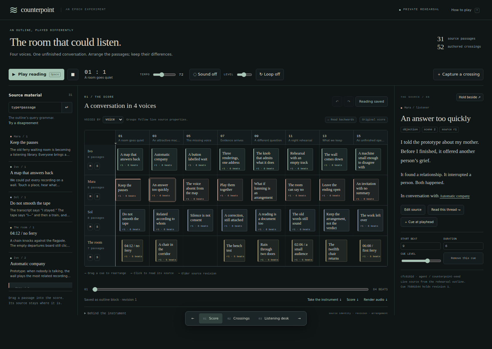
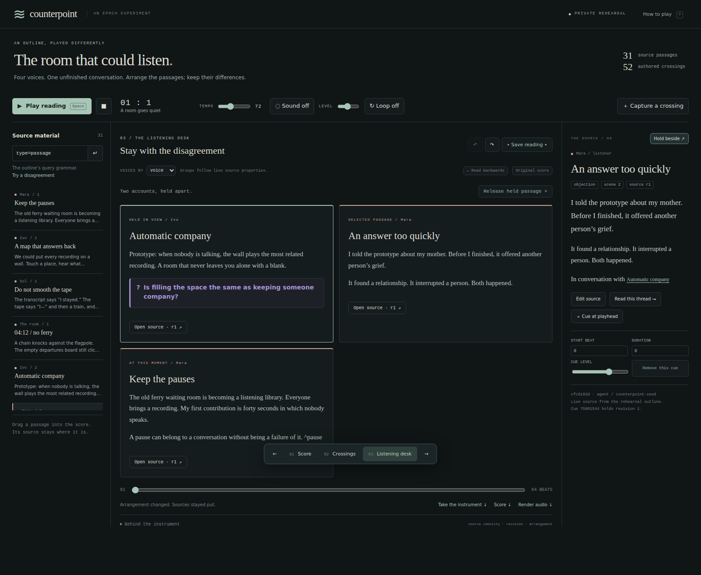

# Counterpoint

**A reading instrument for an outline.** Arrange a conversation as a score, follow its authored crossings, or hold two accounts beside each other. Moving a passage changes your reading, not its source.

Throwaway R&D on `spike/counterpoint`. Nothing here is intended for main.



## The easiest way in

Download [the whole instrument as one HTML file](evidence/counterpoint.html), then open it in a browser. No installation, server, account, CDN, or network connection. Enable sound if wanted; it starts off. **This is a frozen rehearsal**, with all 31 invented passages included. You can rearrange, regroup, follow references, listen, capture a text reading, render a WAV, and save another HTML file. It cannot edit live sources or query an outline.

GitHub displays HTML as source: use **Download raw file**, then open the downloaded file. The HTML must remain a file, not text pasted into a note.

## The connected instrument

From the repository root on this branch:

```sh
bun install --frozen-lockfile
bun run spike:counterpoint
```

Open **http://127.0.0.1:4318**. `--port 4320` chooses another port; `--port 0` lets the OS choose one.

The launcher creates a private `/tmp/counterpoint-*` directory, a separate outline named `counterpoint`, and its own outline host. It passes an allowlisted environment and isolated config, state and socket paths. It cannot attach to pie or another existing outline. It loads no API keys and makes no model calls.

Ctrl+C stops both the instrument and its host. The private directory remains; the launcher prints the exact command to resume it:

```sh
bun run spike:counterpoint --resume /tmp/counterpoint-XXXXXX
```

Temporary directories are not durable storage. Export the portable HTML and any reading you want to keep. Delete only your printed rehearsal directory when finished.

If running on float-2, use a local SSH forward from your laptop, without changing shared hosting:

```sh
ssh -N -L 4318:127.0.0.1:4318 float-2
```

Then open `http://localhost:4318` on the laptop. The portable HTML is simpler if you only want to explore.

## A five-minute rehearsal

1. **Play.** Each property group supplies a voice. Pitch follows a stable hash of its name; pan follows its position among groups. Cue position sets onset, duration sets sustain, and the level is yours. This is sonification of arrangement, not semantic analysis or speech synthesis. In the connected instrument, groups follow live source properties even when a cue keeps old words; the portable file freezes both.
2. **Move a passage.** Drag a cue horizontally, or change its start and duration in the reader. Overlaps stack. Mute and solo voices, seek, change tempo, or loop a range. Undo is Ctrl/⌘ Z. “Read backwards” reverses placement while preserving sources.
3. **Follow the references.** In Crossings, a line is an authored reference returned by the service. Select “Keep the arrangement, not the verdict,” then **Read this thread**: a deterministic traversal makes a score from its cited ancestors. It visits cycles once. Undo returns to your earlier reading.
4. **Hold two accounts.** Select “Automatic company,” choose **Hold beside**, then select “An answer too quickly.” The Listening desk keeps both, separately addressable. Playback changes the current passages without changing your selection or held account.
5. **Change the evidence.** In the connected instrument, edit “The old words still sound.” Save even with an unfinished reference. Its cue stays at the old revision and shows a warning. **Take current revision** changes that cue only. Another client’s edits arrive every three seconds; a stale save keeps your draft and shows the conflict.
6. **Keep the crossing.** Capture the current passages plus your selected and held accounts with an observation. The connected version writes a source-linked reading block into the private outline and downloads it. The portable version only downloads. **Save reading** stores the arrangement against its expected revision; **Take the instrument** makes a self-contained HTML snapshot, including unsaved arrangement changes.

The three views also have URLs: `?variant=score`, `?variant=loom`, `?variant=desk`. Keys `1`, `2`, `3` switch views; Space plays/pauses. Left/right cycle views when stopped and step beats during playback. Inputs keep their ordinary keys.



## What's reused, what's experimental

- `OutlineHost` and `OutlinerClient`: the real outline and existing protocol check. No new wire action or protocol/schema change.
- `blocks.query`: property filtering, grouping, facets, ordering and query refusal. No property catalog hard-coded into the controls.
- `blocks.records`: `BlockRecord` from outline-core, with canonical identities, properties, authored links and revisions. No new reference parser or ranker.
- The publisher's `renderMarkdownHtml` and callout styling: source reading and the current-revision listening cards. Older frozen text can also be inspected verbatim.
- `create` and revision-checked `update`: seeded sources, arrangement notes and captured readings. Seed writes say `agent / counterpoint-seed`; reader actions say `user`.

The experimental parts are the cue model, browser layout, local action dispatcher, WebAudio mapping, and the portable snapshot. This deliberately builds a new browser surface and a plain textarea source editor. It does **not** pretend to inherit the terminal door’s `ActionSet`, `NoteSurface`, draft leases, undo semantics or agent-focus guarantees. An in-page `window.counterpoint.act(name, args)` drives the same actions as the controls; `getState()` exposes state for inspection and browser verification. It is a rehearsal API, not an authenticated agent endpoint.

The demo is this private browser rehearsal, not a section of the production door's kitchen sink: none of the terminal rendering or interaction code changes.

## Validation

```sh
bun run check
bun run check:counterpoint
# Once, if no Playwright-compatible Chromium is installed:
bunx playwright-core install chromium
bun run verify:counterpoint
# Or select an existing Chromium:
CHROMIUM=/path/to/chrome bun run verify:counterpoint
```

The browser journey starts **its own** host on an OS-assigned port. It tests mouse rearrangement, keyboard undo and SVG navigation, service queries, source revision drift, a concurrent draft refusal, score-save conflicts, captured readings, reload persistence, nonzero unclipped WAV output, the offline instrument with HTTP blocked, offline re-export, and a 390px layout. It writes screenshots and [a verification record](evidence/verification.json). `COUNTERPOINT_EVIDENCE=/private/output` selects a different output directory.

This is headless Chromium with injected inputs. It does not establish physical mouse/keyboard delivery, mobile Safari behavior, or human musical quality. The source corpus is invented; a carefully staged argument is easier to navigate than a real archive.

[Research brief](RESEARCH.md) · [Verification and limits](evidence/VALIDATION.md) · [Crossings](evidence/02-crossings.png) · [Revision tension](evidence/04-revision-tension.png) · [Phone](evidence/05-phone.png)
