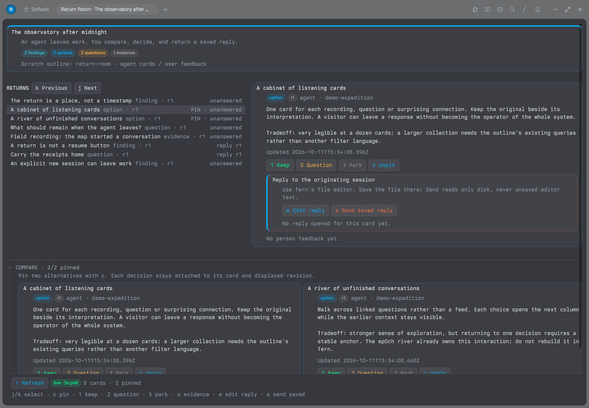

# Return Room

**A native Tern room an agent leaves behind—not another chat transcript.**

Unmerged experiment on `spike/tern-return-room`. Nothing in the normal ep0ch runtime imports this directory. No protocol/schema change, deployment, main-targeting PR, or existing backlog item closure.



## What and why

“Dump a prompt and bounce” makes the return the interesting part. A transcript is excellent at recording sequence and poor at presenting a place to come back to. Return Room gives an expedition a stable arrangement of findings, competing options, unanswered questions and source evidence. The person can inspect and respond without finding the correct terminal, reconstructing the last conversation, or accidentally restarting an agent.

This is a working pair of extensions:

- **Tern:** a native Luau block, theme-aware cards, two-card comparison, keyboard/mouse actions, revision-aware feedback, and evidence files opened through Tern. It is not HTML in a webview or terminal escape-sequence art.
- **omp:** `room_publish` and `room_inbox` tools, plus explicit `/return-room`, `/room-publish` and `/room-pull` commands. A pull adds person-attributed feedback to the originating session without starting inference. Delivery receipts survive session restart and prevent repeat pulls from duplicating context.
- **ep0ch:** the actual outline host stores all cards and responses, with real IDs, revisions and attribution. A dedicated outline holds fictional content. There is no parallel document database, search implementation, property parser or generic note editor.

The deliberately odd premise is that an agent can leave a *room*, not just a reply. Its findings remain inspectable while the person does something else; returning is an editorial act, not a resume button. The seeded room imagines a public garden's listening station. Its observations are explicitly authored demonstration material, not research findings.

### The interaction

Select a card; pin two alternatives; keep, question or park either one. Open its evidence. Edit a reply using **Tern's existing file editor**, save it, then explicitly send the saved file. The reply retains the source revision it was started against—even after the source changes or the pane is recreated. The draft is never cleared on send.

Back in the originating omp session, `/room-pull` imports undelivered responses. Nothing types into another terminal, changes the person's selected card, or treats “keep” as permission to deploy. Another session cannot pull this session's feedback.

Card bodies are **literal Blockdown source**, not a second rich Blockdown renderer. The rich surface here is the native arrangement and interaction; text composition uses the real editor already present in Tern.

## Hypothesis and expected value

**Hypothesis, not a measured result:** returning to a small set of persistent objects will require less reorientation than returning to the end of an agent transcript, especially when the work has competing directions rather than one linear answer.

Three consequences are worth exploring:

1. **Person-paced continuation.** Review can happen without spending tokens or waking an agent. Pulling feedback and asking for another turn are separate decisions.
2. **Disagreement has an address.** A response names a card and an observed revision, not “the thing you said a while ago.” The two alternatives can stay visible together.
3. **One backend permits genuinely different clients.** Tern can offer a small editorial surface without becoming an outliner, replacing Herdr, or absorbing the door's river and workboard.

The experiment proves the mechanical round trip and the native integration are possible with the existing parts. It does **not** prove that people will leave better feedback, return more often, or prefer this arrangement. A polished screenshot is not evidence for those claims.

## Lessons learned

- **The return address must already exist.** omp can have an in-memory session ID before its journal exists. The first no-inference smoke exposed that distinction: custom messages in a never-materialized session did not survive exit. Publishing now refuses an unsaved session, with instructions to start a normal conversation or use `/new`. A durable empty session then passed the real restart/deduplication check without model calls.
- **A draft's revision belongs beside the draft, not just in pane state.** The first implementation retained it through pane reload but could forget it on a new pane. A failing real-host regression exposed that gap. The file now has a persistent revision sidecar; reopening restores the original anchor, and sending against a different anchor is refused without touching the text.
- **Attribution is a service invariant, not a label.** The host refused `author:user` feedback carrying an agent actor. Removing the actor from person-authored writes produced genuinely user-attributed responses. Agent cards still carry actor and originating session.
- **Reusing an editor beats approximating one.** Tern's plugin input API is not its full file editor. Opening a real draft provided selection, deletion, undo and save without writing a weaker editor. The explicit save/send boundary is less seamless but much more honest about which bytes were submitted.
- **Two extension environments are two lifecycles.** Tern's host and window plugins are separate; omp also rebinds extensions across sessions and branches. Saved selection/pins, generation checks and durable delivery messages matter more than decorative UI code.
- **The useful boundary is smaller than a new frontend framework.** Native cards plus a service-backed room were enough. The CLI adapter reused canonical service operations and outline-core's grammar and wire types. Its cost is repeated subprocess startup and a three-second poll; it is not a proposed production subscription architecture.
- **Test the surface that actually loads the extension.** Tern's `serve`/`shot` harness does not load arbitrary plugins. Verification used an ordinary native window with a private control socket, on headless Wayland/Mesa. Plugin reload preserved the two pins. A genuinely narrow split pane exercised the stacked layout; resizing the kiosk window did not change its viewport.
- **Wide comparison is the strongest part; narrow review is crowded.** The split-pane pass kept actions usable but pushed material below the fold. The current selected-card view also repeats a pinned card in the comparison. Neither observation argues for inventing another layout system; a dedicated comparison presentation would be the first UI refinement if this is worth retaining.

## Recommendation

**Keep this as a runnable spike; do not merge it wholesale into main.** The strongest reusable idea is the *addressed return*: source object, observed revision, person response, explicit delivery receipt. That fits ep0ch better than making Tern the next canonical UI.

If the room feels useful during real exploratory work, the first smart step is to make that return contract a shared service capability and let the existing door/Herdr surfaces consume it. Then decide whether this Tern client earns its maintenance cost. Keep the source/response boundary and the existing editor; replace the subprocess polling adapter with an existing persistent service client rather than adding another transport.

**Doing nothing is valid.** If arranging cards merely duplicates the outline, or the person still goes straight to the transcript, archive the branch and retain the evidence and design lesson. This spike does not justify a roadmap commitment, a new component library, or a migration of any existing surface.

## Run it

Requires a checkout with `bun install --frozen-lockfile`, Bun, Tern with native plugins, and omp. Tested with Tern **0.4.5 (1d14241)** and omp **18.9.1** on Linux. Use a new private directory, never the real outlines directory. Run from this worktree's root.

```sh
export RETURN_ROOM_HOME="$(mktemp -d /tmp/return-room.XXXXXX)"
export RETURN_ROOM_CONFIG="$RETURN_ROOM_HOME/room.json"
bun spikes/tern-return-room/demo.ts init "$RETURN_ROOM_HOME"
bun spikes/tern-return-room/demo.ts serve "$RETURN_ROOM_HOME"
```

Keep the host running. In another shell, set `RETURN_ROOM_HOME` to the printed private directory, then:

```sh
export RETURN_ROOM_CONFIG="$RETURN_ROOM_HOME/room.json"
export TERN_CONFIG_DIR="$RETURN_ROOM_HOME/tern"
export TERN_DAEMON_SOCKET="$RETURN_ROOM_HOME/daemon.sock"
export XDG_STATE_HOME="$RETURN_ROOM_HOME/state"
export STENCIL_LOG_DIR="$RETURN_ROOM_HOME/logs"
tern plugin link "$PWD/spikes/tern-return-room/tern"
tern --control "$RETURN_ROOM_HOME/window.sock" "$PWD"
```

Open **Open Return Room** in Tern's command palette. The private daemon must inherit `RETURN_ROOM_CONFIG`; changing only an already-running window's environment will not change its host plugin. The plugin is deliberately **linked to this checkout**: copying just `tern/` elsewhere loses its sibling bridge and is not a supported installation. Tern's normal account requirements still apply.

Start omp with the same config:

```sh
RETURN_ROOM_CONFIG="$RETURN_ROOM_HOME/room.json" \
  omp --extension "$PWD/spikes/tern-return-room/omp-extension.ts"
```

Use an existing saved conversation, or `/new` before manual publication. Then:

```text
/return-room
/room-publish {"title":"A second way through the garden","body":"Keep the source beside the interpretation.","kind":"option"}
```

Respond in Tern, then `/room-pull` in that same omp session. Seed cards belong to the fictional `demo-expedition`, not your session; publish a card to try the full loop. The agent can use `room_publish` during a normal turn; reading with `room_inbox` does not acknowledge delivery.

| Input | Action |
| --- | --- |
| `j` / `k`, arrows, or card click | Select a return |
| `c` or Compare pin | Pin/unpin, maximum two |
| `1` / `2` / `3` or buttons | Keep / question / park |
| `o` or Open evidence | Open source with Tern |
| `e` or Edit reply | Open the revision-anchored draft in Tern's file editor |
| `s` or Send saved reply | Append the file's saved bytes as user feedback |
| `r` or Refresh | Refresh from the scratch host |

Stop the host with Ctrl-C when finished. To discard the demo's running Tern session, while its private window is still open, use `TERN_DAEMON_SOCKET="$RETURN_ROOM_HOME/daemon.sock" tern kill session Default`, then close that window. Keep the private folder to retain the outline and drafts; no cleanup command should target the normal Tern daemon or the real outlines.

## Verification and boundaries

[evidence/round-trip.json](evidence/round-trip.json) contains the observed service card/responses and actual omp RPC events, not a mocked extension API. [research.md](research.md) records the primary API sources; [CONTRACT.md](CONTRACT.md) records the boundary between the clients.

Executed:

- **5 real-host regression tests, 17 assertions, all passing.** Raw capture and attribution; observed vs future revisions; saved-file retention; cross-room refusal; persistent draft anchors across a new Room instance.
- **Strict TypeScript check** of this spike against the repository's Bun types and the installed omp extension declarations: passed. No emitted code or dependency changes.
- **Actual native Tern:** linked host/window plugin loaded; selection, two pins, mouse verdict, keyboard verdict, file edit/select-all/delete/undo/save, explicit send, source-file opening, reload preservation and narrow split-pane rendering.
- **Actual omp RPC process:** registered extension, manual publication through the same schema/implementation as the model tool, explicit feedback pull, duplicate-pull suppression, other-session isolation, process restart with restored receipts, unsaved-session refusal, successful `/new` publication. **Zero `agent_start` events** during these no-inference commands.

The native screenshot is from a real ordinary Tern window rendered on a private Weston headless compositor with Mesa software rendering. Its account gate used Tern's documented `account signed-in` **test display fixture**, not an authenticated Stencil account. No physical-input, macOS, remote-host, provider-inference or whole-repository suite claim is made. This standalone spike is not wired into the door kitchen sink; its seeded native room is its showcase, so it adds no shipped door dependency.

Run the focused suite from the worktree root:

```sh
scripts/agent-env tern-return-check --test -- timeout 900 \
  bun test spikes/tern-return-room/room.test.ts
```

Remaining deliberate boundaries:

- Local, trusted scratch room only. Config is not an authorization boundary or a multi-user access-control system.
- Snapshot limit: 500 notes, including feedback. The UI marks incompleteness and the inbox refuses an incomplete pull rather than silently losing responses.
- Three-second polling and per-operation CLI processes; no background inference. Tern's documented host API exposes pane liveness, not observer visibility. Closing the block stops polling; merely closing its window does not. This is a reason not to ship the spike as a default unattended integration.
- An observed revision is provenance, not a transactional approval or a snapshot of every historical source byte. Feedback never edits the source card.
- Explicit send is append-only, not exactly-once across uncertain process failure. The UI warns to inspect before retrying; repeated intentional sends create separate responses.
- Only saved editor bytes are sent. Unsaved edits remain in the editor; sent drafts stay on disk. Repeated sending does not clear or silently rebase the draft.
- Branch/session guards prevent stale async reads being delivered into a replacement context. Already-started writes may finish against their captured original session after cancellation; inspect the room before retrying publication.
- No production packaging, default plugin registration, owner-outline writes, deployment or main merge.
